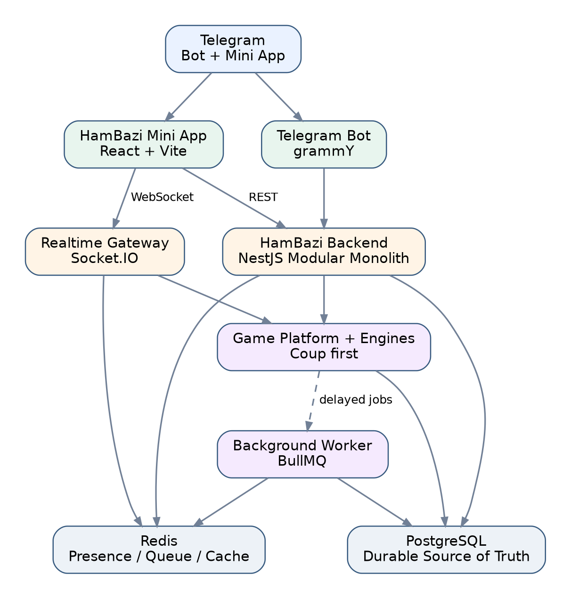
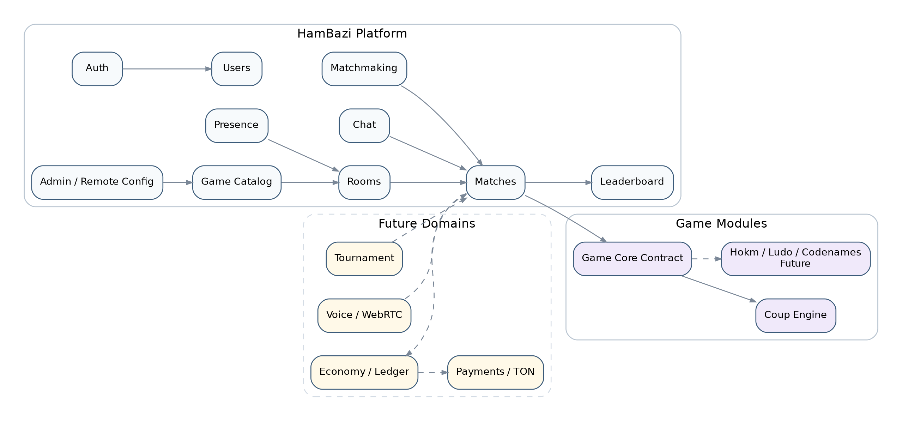
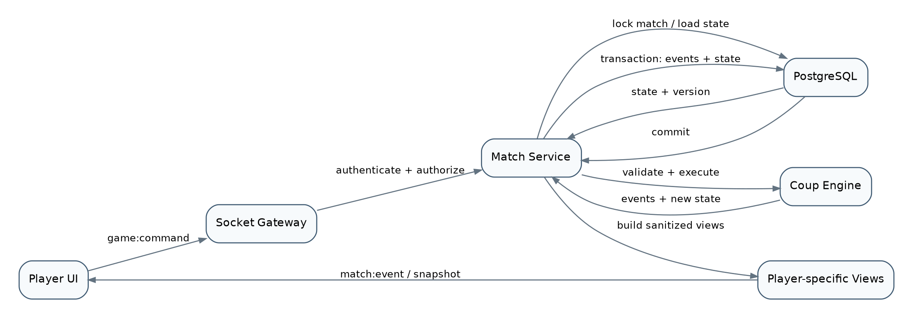
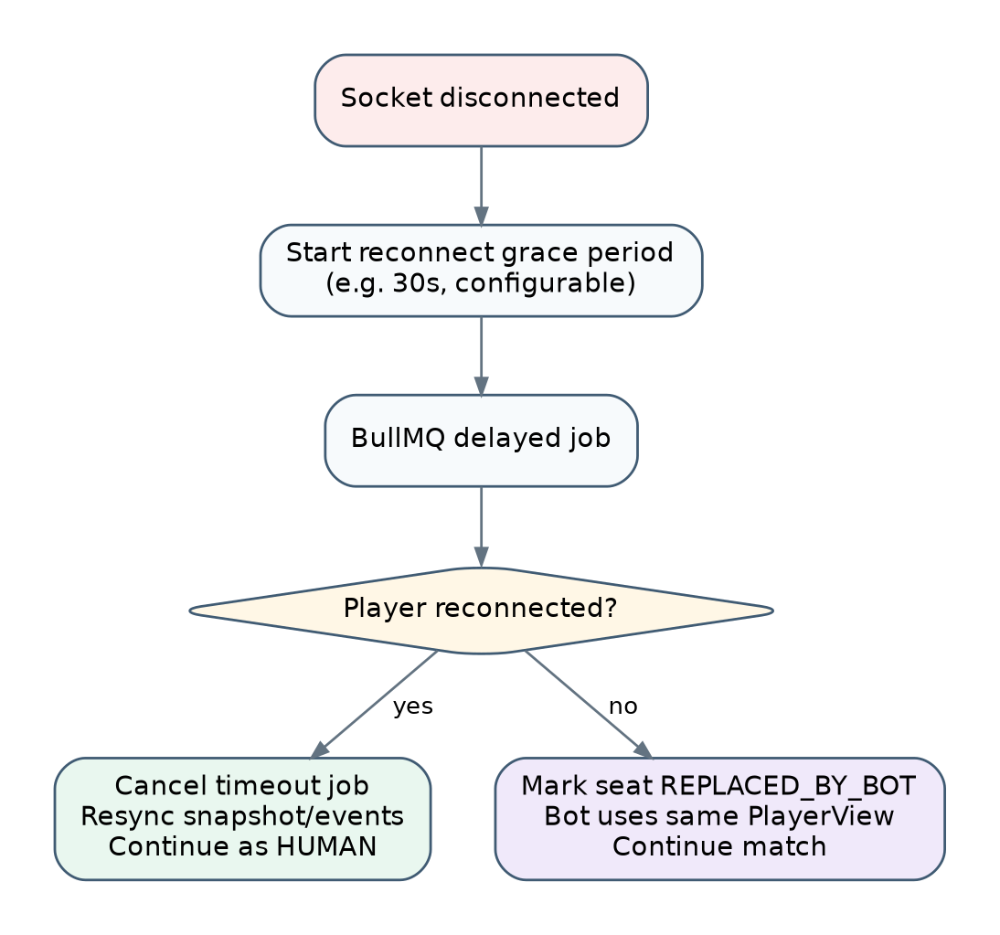
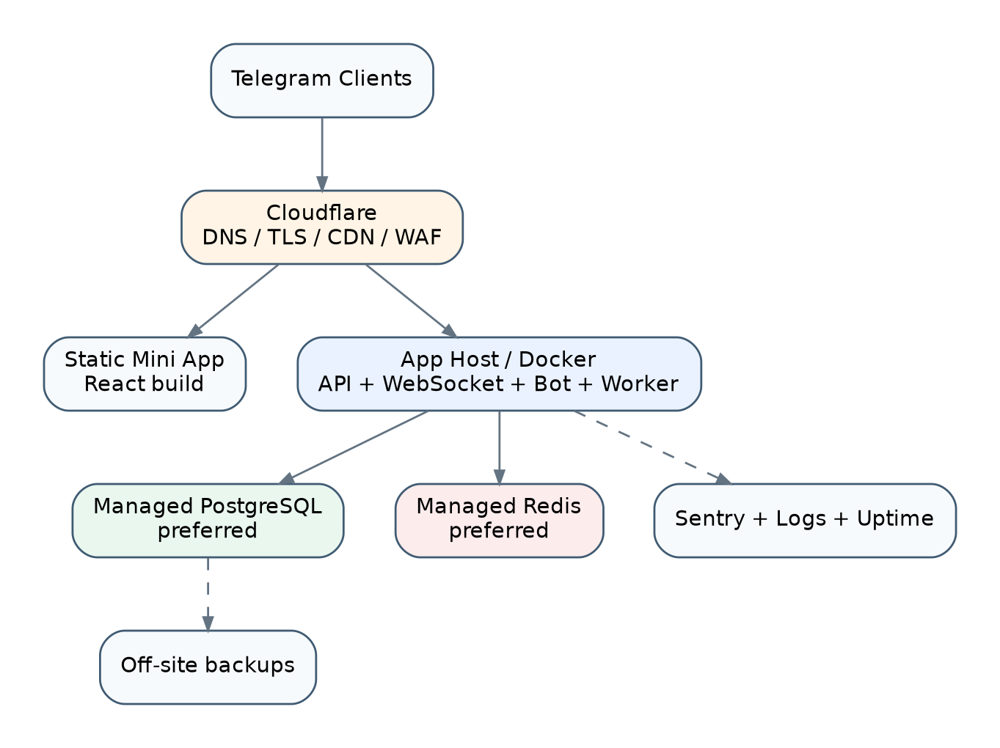

**HamBazi**

**Software Architecture Specification — Reviewed Edition**

سند معماری نرم‌افزار Game Hub در Telegram Mini App

| مقدار                               | مشخصه     |
|------------------------------------------------------------|----------------------------------|
| HamBazi                             | نام محصول |
| Multiplayer Game Hub                | نوع محصول |
| Telegram Bot + Telegram Mini App    | پلتفرم    |
| 1.1                                                        | نسخه سند  |
| MVP production-ready با مسیر رشد چندبازی، Tournament و TON | تمرکز     |
| 8 سپتامبر 2026                                             | تاریخ     |

| تصمیم معماری اصلی HamBazi در MVP یک Modular Monolith با مرزهای ماژولی enforce‌شده است. API/WS، Bot و Worker processهای جدا اما متعلق به یک codebase هستند. Game Server کاملاً Server-Authoritative است و هر Match با الگوی single-writer، تراکنش کوتاه PostgreSQL و Transactional Outbox تغییر می‌کند. |
|-----------------------------------------------------------------------------------------------------------------------------------------------------------------------------------------------------------------------------------------------------------------------------------------------------|

# فهرست بخش‌ها

| [1. خلاصه اجرایی و اهداف معماری](#خلاصه-اجرایی-و-اهداف-معماری)                   | [16. Security Architecture](#security-architecture)                                  |
|----------------------------------------------------------------------------------|--------------------------------------------------------------------------------------|
| [2. محدوده MVP و موارد خارج از محدوده](#محدوده-mvp-و-موارد-خارج-از-محدوده)       | [17. Leaderboard و Stats](#leaderboard-و-stats)                                      |
| [3. اصول و تصمیم‌های معماری](#اصول-و-تصمیمهای-معماری)                             | [18. Background Jobs](#background-jobs)                                              |
| [4. Stack پیشنهادی](#stack-پیشنهادی)                                             | [19. Deployment و Infrastructure](#deployment-و-infrastructure)                      |
| [5. معماری کلان سیستم](#معماری-کلان-سیستم)                                       | [20. Scaling Strategy](#scaling-strategy)                                            |
| [6. معماری Telegram Bot و Authentication](#معماری-telegram-bot-و-authentication) | [21. Observability و Operations](#observability-و-operations)                        |
| [7. Game Platform و Game Registry](#game-platform-و-game-registry)               | [22. Testing Strategy](#testing-strategy)                                            |
| [8. Rooms و Invitation](#rooms-و-invitation)                                     | [23. Repository و Folder Structure](#repository-و-folder-structure)                  |
| [9. Matchmaking](#matchmaking)                                                   | [24. CI/CD و Release Strategy](#cicd-و-release-strategy)                             |
| [10. Match Lifecycle و Realtime](#match-lifecycle-و-realtime)                    | [25. Roadmap توسعه MVP](#roadmap-توسعه-mvp)                                          |
| [11. Game Engine و Coup Engine](#game-engine-و-coup-engine)                      | [26. معماری آینده: Tournament / Economy / TON](#معماری-آینده-tournament-economy-ton) |
| [12. Disconnect، Reconnect و Bot Takeover](#disconnect-reconnect-و-bot-takeover) | [27. ADRها، ریسک‌ها و Definition of Done](#adrها-ریسکها-و-definition-of-done)         |
| [13. Chat و Voice آینده](#chat-و-voice-آینده)                                    | [28. فرهنگ واژگان و تصمیم‌های باز](#فرهنگ-واژگان-و-تصمیمهای-باز)                      |
| [14. معماری داده و دیتابیس](#معماری-داده-و-دیتابیس)                              | [29. منابع رسمی و نکات اعتبارسنجی‌شده](#منابع-رسمی-و-نکات-اعتبارسنجیشده)              |
| [15. REST API و WebSocket Contract](#rest-api-و-websocket-contract)              |                                                                                      |

# 1. خلاصه اجرایی و اهداف معماری

HamBazi یک Game Hub چندنفره در بستر Telegram است که تجربه کاربر از Bot آغاز می‌شود و بخش اصلی Gameplay داخل Telegram Mini App اجرا خواهد شد. MVP با یک بازی، Coup، شروع می‌شود اما معماری باید برای اضافه شدن بازی‌های کارتی و رومیزی مانند حکم، منچ و Codenames بدون بازنویسی زیرساخت مشترک آماده باشد.

هدف این سند تعیین معماری مرجع برای توسعه MVP و تعریف مسیر رشد محصول است؛ به‌گونه‌ای که تیم بتواند تصمیم‌های فنی را بر اساس یک منبع واحد اتخاذ کند، توسعه بازی‌های جدید را استاندارد کند و از ایجاد یک Monolith درهم‌تنیده یا Microservice زودهنگام جلوگیری کند.

<table>
<colgroup>
<col style="width: 100%" />
</colgroup>
<thead>
<tr class="header">
<th>
اصل حیاتی

HamBazi یک «اپ Coup» نیست؛ HamBazi یک Multiplayer Game Platform است و Coup اولین Game Module آن محسوب می‌شود.
</th>
</tr>
</thead>
<tbody>
</tbody>
</table>

## 1.1 اهداف کیفی

- سرعت توسعه بالا برای MVP و تیم کوچک.

- امنیت در بازی‌های دارای اطلاعات مخفی و جلوگیری از اعتماد به Client.

- قابلیت افزودن Game Moduleهای جدید با کمترین تکرار کد.

- پایداری در disconnect/reconnect و حفظ Match.

- مسیر Scale روشن بدون تحمیل پیچیدگی Microservices از روز اول.

- قابل تست بودن Game Logic مستقل از UI، Telegram و Framework.

- قابلیت توسعه آینده برای Tournament، Economy، Payments، TON و Voice.

## 1.2 الزامات غیرعملکردی اولیه

| هدف MVP                                          | معیار              |
|-------------------------------------------------------------------------|-------------------------------------------|
| Server-authoritative + validation همه commandها  | Integrity بازی     |
| Reconnect grace period و snapshot sync           | Resilience         |
| Event log + structured logging                   | Debuggability      |
| Modular Monolith با مرزهای دامنه‌ای               | Maintainability    |
| PostgreSQL durable truth + Redis ephemeral state | Consistency        |
| Docker-based deployment                          | Portability        |
| Kill switch و remote config برای Gameها          | Operational safety |

## 1.3 جمع‌بندی بازبینی معماری

جهت‌گیری نسخه 1.0 درست و متناسب با تیم کوچک بود، اما چند تصمیم حیاتی در سطح اصل باقی مانده و برای پیاده‌سازی production-ready به قرارداد قابل تست تبدیل نشده بود. نسخه 1.1 این شکاف‌ها را بدون تبدیل زودهنگام سیستم به Microservices برطرف می‌کند.

| **اصلاح نسخه 1.1**                                                                                           | **ضعف یا ابهام نسخه 1.0**                                   |
|--------------------------------------------------------------------------------------------------------------|-------------------------------------------------------------|
| matches.state_jsonb آخرین snapshot معتبر است؛ game_events audit/replay و هر دو در یک transaction ثبت می‌شوند. | ابهام بین snapshot و Event Sourcing به‌عنوان Source of Truth |
| ثبت outbox_events در همان transaction و ارسال at-least-once با consumerهای idempotent.                       | شکاف بین DB commit، broadcast، stats و job enqueue          |
| single-writer per match، state_version، actionId یکتا و lock کوتاه با retry محدود.                           | رقابت commandها و امکان double-apply                        |
| تعریف delivery semantics، seq، resync، Redis adapter، session affinity و connection draining.                | Scale افقی WebSocket بدون جزئیات load balancer              |
| engine_version و state_schema_version برای هر Match و migration/upcaster تست‌شده.                             | Deploy نسخه جدید Engine روی Match فعال                      |
| Clock و RandomSource تزریقی، CSPRNG سمت Server و رویدادهای قابل replay.                                      | زمان و randomness غیرقطعی و دشواری debug/replay             |
| SLO، RPO/RTO، alert threshold و load-test gate قابل‌اندازه‌گیری.                                               | NFRهای کیفی بدون معیار پذیرش                                |
| ماتریس وابستگی ماژول‌ها و fitness test در CI.                                                                 | مرزهای Modular Monolith صرفاً قراردادی                       |
| سیاست session، logging امن، webhook secret، RBAC عملیاتی و data retention.                                   | کنترل‌های امنیت، حریم خصوصی و عملیات ناقص                    |
| Linked TOC، Heading واقعی، شماره صفحه، RTL یکدست، جدول‌های قابل تکرار و glossary.                             | ساختار Word غیرsemantic و خوانایی پایین در متن دو‌زبانه      |

## 1.4 اهداف غیرعملکردی و Release Gates

اعداد زیر baseline اولیه‌اند و باید با داده محصول و هزینه زیرساخت در ADR تثبیت شوند. عبور از Release Gate بدون ثبت نتیجه load test، restore rehearsal و security checks مجاز نیست.

| **Release Gate / روش سنجش**                                   | **Baseline MVP**                                                  | **ویژگی کیفی**    |
|---------------------------------------------------------------|-------------------------------------------------------------------|-------------------|
| محاسبه ماهانه روی مسیر Auth → Room/Match → Finish             | Critical-path availability \>= 99.5%                              | دسترس‌پذیری        |
| Load test در region هدف با دو برابر پیک پیش‌بینی‌شده            | REST p95 \<= 500 ms; command commit+ack p95 \<= 300 ms            | Latency           |
| timestamp سرور روی commit و publish؛ خارج از animation client | Match-event fanout p95 \<= 500 ms                                 | Realtime          |
| آزمون شبکه ناپایدار و reopen در Telegram                      | Reconnect success \>= 95% within grace period                     | Resilience        |
| replay و reconciliation خودکار                                | Zero lost accepted commands; zero duplicate side effects          | Consistency       |
| PITR یا backup متناسب با بودجه + restore rehearsal            | RPO \<= 15 min; RTO \<= 4 h                                       | Disaster Recovery |
| PlayerView diff/property tests و security scan CI             | Zero hidden-state leaks; zero known Critical/High vulnerabilities | Security          |
| requestId/matchId/actionId coverage + alert drill             | 100% critical-path correlation; target MTTD \<= 5 min             | Operability       |

# 2. محدوده MVP و موارد خارج از محدوده

## 2.1 قابلیت‌های داخل MVP

- Telegram Bot با /start و جریان ایجاد حساب کاربری.

- پروفایل اولیه و public handle منحصر‌به‌فرد مانند mehdi_65022.

- منوی Games و Game Catalog.

- یک بازی فعال: Coup.

- صفحه مشترک Game Lobby با تعداد آنلاین، تنظیمات پایه، Online Play و Invite Friends.

- Matchmaking آنلاین با Search و Cancel.

- Private Room با انتخاب ظرفیت، invite link، share link، نمایش اعضا و Start توسط Host.

- Realtime Game Session با Socket.IO.

- Coup Engine سمت Server با state machine و اطلاعات خصوصی برای هر بازیکن.

- Reconnect و جایگزینی Bot پس از timeout قابل تنظیم.

- Text Chat داخل Match.

- Leaderboard اولیه و Profile statistics.

## 2.2 عمداً خارج از MVP

- TON و Wallet connection.

- پرداخت، Telegram Stars و Economy دارای ارزش مالی.

- Tournament.

- Voice Chat.

- Friends/Clan/Guild.

- Store، Skin و Achievement پیشرفته.

- Kubernetes، Kafka، Elasticsearch و Microservices production deployment.

- Advanced ML anti-cheat.

<table>
<colgroup>
<col style="width: 100%" />
</colgroup>
<thead>
<tr class="header">
<th>
قاعده Scope

هر Feature جدید فقط زمانی وارد MVP می‌شود که برای تکمیل loop اصلی Account → Find/Invite → Play Coup → Finish → Stats ضروری باشد.
</th>
</tr>
</thead>
<tbody>
</tbody>
</table>

# 3. اصول و تصمیم‌های معماری

| توضیح                                                                                                      | اصل                    |
|-----------------------------------------------------------------------------------------------------------------------------------|-----------------------------------------------|
| یک backend deployable در MVP، با module boundary سخت و dependency direction مشخص.                          | Modular Monolith       |
| Client فقط intention/command ارسال می‌کند؛ State، rule validation، timer و outcome در Server تعیین می‌شوند.  | Server Authoritative   |
| Game Engine هیچ وابستگی به NestJS، Telegram، DB یا Socket.IO ندارد و Pure TypeScript است.                  | Game Engine Isolation  |
| PostgreSQL حقیقت durable؛ Redis برای presence، queue، cache، coordination و داده موقت.                     | Durable vs Ephemeral   |
| Room، Matchmaking، Match، Presence و Chat عمومی هستند؛ Coup فقط rule engine و UI مخصوص خود را دارد.        | Generic Platform First |
| Actionهای بازی به eventهای دامنه‌ای تبدیل می‌شوند تا audit/debug/reconnect قابل اتکا باشند.                  | Event-Aware State      |
| وقتی نیاز واقعی ایجاد شد، Game Session یا Matchmaking از Modular Monolith به service مستقل استخراج می‌شوند. | Scale by Extraction    |

## 3.1 مرز ماژول‌ها و Dependency Matrix

هر ماژول مالک مدل دامنه، use caseها و repository interface خود است. دسترسی مستقیم به جدول یا repository ماژول دیگر ممنوع است؛ تعامل sync فقط از application port و تعامل async فقط از domain event نسخه‌دار انجام می‌شود.

| **ممنوع**                           | **وابستگی مجاز**                  | **مالکیت اصلی**                         | **ماژول**    |
|-------------------------------------|-----------------------------------|-----------------------------------------|--------------|
| Game/Room repository                | Users port                        | Telegram validation، session، identity  | Auth         |
| Telegram SDK در domain              | ندارد یا Shared Kernel محدود      | Profile، handle، settings               | Users        |
| Match state                         | Config port                       | GameDefinition، capability، kill switch | Game Catalog |
| Game Engine مستقیم                  | Users + Game Catalog ports        | Lobby، membership، host، invite         | Rooms        |
| Room/Match table access             | Eligibility + Match creation port | Ticket، queue، reservation              | Matchmaking  |
| Telegram/Socket/Prisma در Game Core | Users، optional Room، Game Engine | Match lifecycle، state، result          | Matches      |
| Business rule در Gateway            | Application use cases             | Socket auth، rooms، ack، fanout         | Realtime     |
| خواندن hidden state                 | Match membership port             | Message، rate limit، moderation hooks   | Chat         |
| تغییر Match                         | MatchFinished event               | Stats projection، ranks                 | Leaderboard  |
| mutation مستقیم DB خارج از use case | Application ports                 | Timeout، outbox dispatch، cleanup       | Worker       |

## 3.2 Architecture Fitness Functions

- CI با ESLint boundaries یا dependency-cruiser importهای ممنوع بین moduleها را fail می‌کند.

- Game Engine package نباید dependency runtime به NestJS، Prisma، Redis، Socket.IO یا Telegram SDK داشته باشد.

- هر تغییر OpenAPI، command/event schema و database migration دارای compatibility check است.

- Replay یک Match با engine_version ثبت‌شده باید به state و result یکسان برسد.

- هیچ log، trace یا error report شامل initData خام، token، deck یا کارت‌های سایر بازیکنان نیست.

# 4. Stack پیشنهادی

| چرایی                                                                         | انتخاب                                      | بخش            |
|------------------------------------------------------------------------------------------------------|--------------------------------------------------------------------|---------------------------------------|
| اشتراک type/contract بین Bot، API، UI و Engine.                               | TypeScript                                  | زبان مشترک     |
| SPA تعاملی، startup سبک، نیاز کم به SSR/SEO.                                  | React + Vite                                | Mini App       |
| تفکیک server-state از local UI/game-session state.                            | TanStack Query + Zustand                    | Frontend State |
| سرعت توسعه و consistency UI.                                                  | Tailwind CSS                                | Styling        |
| عدم وابستگی کل platform به game engine تصویری.                                | React؛ Phaser فقط برای gameهای canvas-heavy | Game Rendering |
| ساختار module-based، DI، REST و WebSocket integration.                        | NestJS + Fastify                            | Backend        |
| rooms، reconnect semantics، acknowledgements و integration مناسب با NestJS.   | Socket.IO                                   | Realtime       |
| TypeScript-friendly و مناسب برای flowهای Bot.                                 | grammY                                      | Telegram Bot   |
| transaction، consistency و JSONB برای stateهای game.                          | PostgreSQL                                  | Database       |
| schema/migration/type safety و DX مناسب برای MVP.                             | Prisma                                      | ORM            |
| presence، matchmaking، rate limit، cache، queue backend و future leaderboard. | Redis                                       | Redis          |
| delayed disconnect jobs، expiration و کارهای async.                           | BullMQ                                      | Jobs           |
| unit/domain tests و E2E.                                                      | Vitest + Playwright                         | Testing        |
| structured logging با overhead پایین.                                         | Pino                                        | Logging        |
| MVP observability کافی بدون stack سنگین.                                      | Sentry + uptime + structured logs           | Monitoring     |
| اشتراک packages و build/test orchestration.                                   | pnpm Workspaces + Turborepo                 | Monorepo       |
| سادگی عملیاتی و مسیر scale مناسب.                                             | Docker + Cloudflare + VPS/Managed DB        | Infrastructure |
| اعتبارسنجی runtime مشترک برای REST، Socket و config.                                                 | Zod یا JSON Schema                                                 | Schema Validation                     |
| مستندسازی قرارداد sync و eventهای realtime.                                                          | OpenAPI + AsyncAPI/event catalog                                   | API Contracts                         |
| trace propagation و vendor-neutral telemetry.                                                        | OpenTelemetry-compatible instrumentation                           | Tracing                               |

نسخه دقیق packageها در زمان implementation باید از latest stable compatible release انتخاب و در lockfile قفل شود؛ این سند به عمد روی معماری و contract تمرکز دارد نه شماره نسخه‌هایی که به‌سرعت تغییر می‌کنند.

# 5. معماری کلان سیستم

شکل 1 — معماری کلان پیشنهادی HamBazi در MVP

Telegram Bot و Mini App هر دو Clientهای HamBazi Backend هستند. Business Logic اصلی داخل Bot قرار نمی‌گیرد. Bot مسئول interaction تلگرامی، account onboarding، menuها و باز کردن Mini App است؛ Backend مرجع Users، Rooms، Matchmaking، Matches و Game State است.

شکل 2 — مرزبندی دامنه‌ها و Game Moduleها

## 5.1 Dependency Rule

<table>
<colgroup>
<col style="width: 100%" />
</colgroup>
<thead>
<tr class="header">
<th>UI / Bot -&gt; Application Services -&gt; Domain / Game Core 
| 
+-&gt; Repositories / Infrastructure 
 
Game Engine MUST NOT import: 
- NestJS 
- Prisma 
- Redis 
- Socket.IO 
- Telegram SDK</th>
</tr>
</thead>
<tbody>
</tbody>
</table>

## 5.2 دید منطقی در برابر دید استقرار

Realtime Gateway در MVP یک مرز منطقی داخل apps/api است، نه Microservice مستقل. deployment baseline سه process دارد: API+WebSocket، Telegram Bot و Worker. همه از packageهای application/domain مشترک استفاده می‌کنند، اما Bot و Gateway فقط adapter هستند و Business Logic را مالک نمی‌شوند.

| **Failure boundary**               | **Deployable** | **مسئولیت**                            |
|------------------------------------|----------------|----------------------------------------|
| Restart بدون توقف jobها یا Bot     | apps/api       | REST، WebSocket، application use cases |
| Webhook/update backlog مستقل       | apps/bot       | Telegram update و menu/orchestration   |
| Retry/DLQ مستقل از request latency | apps/worker    | Outbox، timeout، stats، cleanup        |
| Static release مستقل و cacheable   | apps/web       | Telegram Mini App                      |

# 6. معماری Telegram Bot و Authentication

## 6.1 جریان ایجاد حساب

<table>
<colgroup>
<col style="width: 100%" />
</colgroup>
<thead>
<tr class="header">
<th>/start 
-&gt; Has account? 
NO -&gt; [Create Account] 
-&gt; Ask display name 
-&gt; Backend creates user 
-&gt; Generate unique public_handle 
YES -&gt; Show full menu</th>
</tr>
</thead>
<tbody>
</tbody>
</table>

شناسه نمایشی مانند mehdi_65022 نباید Primary Key باشد. هر User باید حداقل سه شناسه مجزا داشته باشد: Internal ID، telegram_user_id و public_handle. Internal ID در روابط دیتابیس استفاده می‌شود، Telegram ID برای identity mapping و Public Handle برای نمایش و جست‌وجوی آینده.

| قانون                                        | فیلد              |
|---------------------------------------------------------------------|------------------------------------------|
| UUID/ULID application-generated، غیرقابل حدس | id                |
| Unique و BigInt-safe                         | telegram_user_id  |
| نام کاربر، قابل تغییر با rule محصول          | display_name      |
| Unique، public و non-authoritative           | public_handle     |
| اختیاری                                      | telegram_username |

## 6.2 Authentication Mini App

Mini App باید Telegram initData خام را به Backend ارسال کند. Backend signature و freshness را اعتبارسنجی کرده و سپس User را resolve می‌کند. داده initDataUnsafe یا telegram id ارسال‌شده توسط Client به‌تنهایی قابل اعتماد نیست.

<table>
<colgroup>
<col style="width: 100%" />
</colgroup>
<thead>
<tr class="header">
<th>Telegram Client 
-&gt; Mini App gets initData 
-&gt; POST /v1/auth/telegram-mini-app 
-&gt; Verify signature/hash 
-&gt; Validate auth_date freshness 
-&gt; Resolve Telegram user 
-&gt; Resolve/Create HamBazi session 
-&gt; Return short-lived application session</th>
</tr>
</thead>
<tbody>
</tbody>
</table>

<table>
<colgroup>
<col style="width: 100%" />
</colgroup>
<thead>
<tr class="header">
<th>
Security Gate

هیچ Game/Room/Match API یا WebSocket connection نباید فقط بر اساس userId موجود در payload احراز هویت شود. identity همیشه از session معتبر مشتق می‌شود.
</th>
</tr>
</thead>
<tbody>
</tbody>
</table>

## 6.3 Invite onboarding

برای دعوت، کاربر مهمان نباید مجبور شود مسیر Bot را کامل کند و دوباره لینک را باز کند. اگر کاربر از startapp وارد Room شد و حساب ندارد، یک onboarding کوتاه داخل Mini App انجام می‌شود و همان UserService مشترک حساب را ایجاد می‌کند.

# 7. Game Platform و Game Registry

Game Catalog باید metadata و capabilityهای هر بازی را از Backend برگرداند. UI عمومی Game Lobby بر اساس این config ساخته می‌شود و hardcode برای Coup حداقل می‌ماند.

<table>
<colgroup>
<col style="width: 100%" />
</colgroup>
<thead>
<tr class="header">
<th>GameDefinition { 
id: string 
slug: string 
title: string 
minPlayers: number 
maxPlayers: number 
matchmakingEnabled: boolean 
privateRoomsEnabled: boolean 
chatEnabled: boolean 
voiceEnabled: boolean 
status: ACTIVE | MAINTENANCE | DISABLED 
}</th>
</tr>
</thead>
<tbody>
</tbody>
</table>

## 7.1 Remote Config

پارامترهای عملیاتی مانند turn timeout، disconnect grace period، chat enabled و matchmaking enabled باید تا حد امکان از Backend config شوند. این موضوع امکان kill switch و واکنش سریع به bug را بدون انتشار مجدد Mini App فراهم می‌کند.

| نمونه                           | Config           |
|--------------------------------------------------------|-----------------------------------------|
| ACTIVE / MAINTENANCE / DISABLED | Game status      |
| 30 ثانیه، قابل تنظیم            | Turn timeout     |
| 30 ثانیه، قابل تنظیم            | Disconnect grace |
| true/false                      | Matchmaking      |
| true/false                      | Private rooms    |
| true در MVP                     | Text chat        |
| false در MVP                    | Voice            |

## 7.2 قرارداد کامل Game Module

| **قاعده**                                                       | **جزء قرارداد**            |
|-----------------------------------------------------------------|----------------------------|
| id/slug، min/max players، modeها، capabilityها و status         | Game Manifest              |
| engineVersion، stateSchemaVersion، command/event schema version | Version Descriptor         |
| Pure TypeScript؛ بدون I/O و framework dependency                | Server Engine              |
| Clock، RandomSource و RuleConfig به‌صورت explicit dependency     | Deterministic Dependencies |
| PlayerView و SpectatorView جدا؛ deny-by-default                 | View Projector             |
| deadline policy، timeout command و reconnect behavior           | Timer Policy               |
| نتیجه استاندارد: placements، winner، reason، metrics            | Result Mapper              |
| validate/migrate snapshot و upcast eventهای قدیمی               | State Migration            |
| route، renderer، assets و mapping event→UI بدون rule authority  | Frontend Adapter           |
| strategy version و همان PlayerView انسان                        | Bot Policy                 |

هر Match در زمان ایجاد engine_version، state_schema_version و ruleset_version را pin می‌کند. deployment جدید نباید semantics بازی فعال را silently تغییر دهد؛ migration یا ادامه اجرای نسخه سازگار باید از قبل تست شده باشد.

# 8. Rooms و Invitation

## 8.1 Room State Machine

<table>
<colgroup>
<col style="width: 100%" />
</colgroup>
<thead>
<tr class="header">
<th>WAITING -&gt; FULL -&gt; STARTING -&gt; STARTED -&gt; CLOSED 
^ | 
+--------+ (player leaves before start) 
 
Any waiting room may become EXPIRED by timeout.</th>
</tr>
</thead>
<tbody>
</tbody>
</table>

Host اتاق را می‌سازد، ظرفیت را انتخاب می‌کند و Backend یک inviteCode تصادفی و غیرقابل حدس تولید می‌کند. عضویت، capacity و permissionها صرفاً سمت Backend enforce می‌شوند.

## 8.2 Host rules

- فقط Host می‌تواند Start را درخواست کند.

- Start فقط وقتی capacity کامل و Room در state مجاز است انجام می‌شود.

- اگر عضو قبل از Start خارج شود، state از FULL به WAITING برمی‌گردد.

- اگر Host قبل از شروع خارج شود، Host به قدیمی‌ترین عضو باقی‌مانده منتقل می‌شود؛ Room بی‌دلیل نابود نمی‌شود.

- هر Join باید idempotent باشد تا refresh یا retry عضو تکراری ایجاد نکند.

## 8.3 Deep Link

<table>
<colgroup>
<col style="width: 100%" />
</colgroup>
<thead>
<tr class="header">
<th>https://t.me/&lt;bot&gt;/&lt;app&gt;?startapp=room_&lt;opaqueInviteCode&gt; 
 
Mini App: 
start_param -&gt; resolve invite -&gt; authenticate -&gt; join room -&gt; subscribe realtime</th>
</tr>
</thead>
<tbody>
</tbody>
</table>

# 9. Matchmaking

Matchmaking برای بازی‌های turn-based MVP می‌تواند بر پایه Redis queue/ordered set طراحی شود. Queue بر اساس game و mode/capacity جدا می‌شود. PostgreSQL نتیجه نهایی Match را durable می‌کند.

<table>
<colgroup>
<col style="width: 100%" />
</colgroup>
<thead>
<tr class="header">
<th>matchmaking:coup:4 
userA 
userB 
userC 
userD 
 
=&gt; atomic claim =&gt; Create Match =&gt; notify players</th>
</tr>
</thead>
<tbody>
</tbody>
</table>

## 9.1 Entry states

| توضیح                      | State     |
|---------------------------------------------------|----------------------------------|
| در صف و قابل match         | SEARCHING |
| به یک Match تخصیص یافته    | MATCHED   |
| کاربر Cancel کرده          | CANCELLED |
| timeout یا session invalid | EXPIRED   |

Cancel و Match-found ممکن است همزمان رخ دهند؛ بنابراین transition از SEARCHING باید atomic باشد. فقط یکی از MATCHED یا CANCELLED مجاز است برنده race شود.

## 9.2 سیاست MVP

- در MVP skill-based matchmaking لازم نیست.

- اولویت با زمان انتظار است.

- اگر game mode ظرفیت‌های مختلف دارد، queueها مستقل باشند.

- پس از Match Found، room/match admission با token/session داخلی محدود شود تا user خارجی join نکند.

## 9.3 پروتکل Atomic Matchmaking

- برای هر user/game/mode فقط یک active ticket مجاز است؛ enqueue و cancel با token یکتا و Lua/transaction اتمیک انجام می‌شوند.

- Matcher اعضا را ابتدا با reservation TTL claim می‌کند؛ سپس Match و match_players در PostgreSQL ساخته می‌شوند.

- اگر DB commit شکست خورد، reservation آزاد می‌شود؛ اگر notify شکست خورد، outbox دوباره آن را ارسال می‌کند.

- Match found فقط پس از DB commit معتبر است. Client با matchId و admission token کوتاه‌عمر وارد می‌شود.

- خاموشی Redis نباید Match ثبت‌شده را حذف کند؛ فقط ticketهای موقت از بین می‌روند و Client می‌تواند search را idempotently تکرار کند.

# 10. Match Lifecycle و Realtime

## 10.1 Match states

<table>
<colgroup>
<col style="width: 100%" />
</colgroup>
<thead>
<tr class="header">
<th>CREATED -&gt; WAITING_FOR_PLAYERS -&gt; READY -&gt; STARTING -&gt; ACTIVE -&gt; FINISHED 
| 
+-&gt; TERMINATED</th>
</tr>
</thead>
<tbody>
</tbody>
</table>

Room یک پیش‌مرحله اجتماعی/دعوتی است؛ Match شیء durable مربوط به اجرای بازی است. در Matchmaking ممکن است Match بدون Private Room ایجاد شود. Game Engine فقط از STARTING/ACTIVE به بعد درگیر ruleهای بازی می‌شود.

## 10.2 REST vs WebSocket

| نمونه                                                                             | کانال     |
|----------------------------------------------------------------------------------------------------------|----------------------------------|
| Auth، Profile، Game Catalog، Leaderboard، Room create/read                        | REST      |
| Room membership updates، Matchmaking status، Game commands/events، Presence، Chat | WebSocket |

## 10.3 Socket events پایه

<table>
<colgroup>
<col style="width: 100%" />
</colgroup>
<thead>
<tr class="header">
<th>room:player_joined 
room:player_left 
room:host_changed 
room:ready 
 
matchmaking:started 
matchmaking:cancelled 
matchmaking:found 
 
match:started 
match:snapshot 
match:event 
match:finished 
 
player:disconnected 
player:reconnected 
player:bot_takeover 
 
chat:message</th>
</tr>
</thead>
<tbody>
</tbody>
</table>

## 10.4 Delivery Semantics و Ordering

| **رفتار Client/Consumer**                              | **تضمین Server**                                 | **مسیر**                |
|--------------------------------------------------------|--------------------------------------------------|-------------------------|
| Retry با همان actionId؛ conflict → resync              | Command at-most-once effect، نه لزوماً یک request | Client → Server         |
| Deduplicate بر اساس seq؛ gap → request snapshot/events | at-least-once delivery با seq افزایشی per Match  | Server → Player         |
| Handler idempotent با eventId                          | at-least-once از outbox                          | Domain event → Consumer |
| Snapshot را فقط اگر version جدیدتر است جایگزین کند     | snapshot شامل stateVersion و lastEventSeq        | Reconnect               |

## 10.5 Scale افقی Socket.IO

- در چند instance از Redis adapter برای fanout بین nodeها استفاده می‌شود؛ Redis در شبکه private، با ACL/TLS و credential اختصاصی قرار می‌گیرد.

- اگر HTTP long-polling فعال باشد، load balancer باید session affinity داشته باشد. WebSocket-only فقط پس از تست سازگاری Telegram clientها انتخاب می‌شود.

- هنگام deploy، instance ابتدا readiness را false می‌کند، connection جدید نمی‌پذیرد، connectionهای موجود را drain می‌کند و سپس خاموش می‌شود.

- قطع Redis adapter باعث محدود شدن broadcast به clientهای همان node می‌شود؛ health alert و reconnect/resync این failure mode را آشکار و recover می‌کند.

# 11. Game Engine و Coup Engine

<table>
<colgroup>
<col style="width: 100%" />
</colgroup>
<thead>
<tr class="header">
<th>
Non-negotiable

Game State کامل هرگز به Client ارسال نمی‌شود. برای هر بازیکن یک PlayerView sanitised ساخته می‌شود که فقط اطلاعات مجاز آن Seat را شامل می‌شود.
</th>
</tr>
</thead>
<tbody>
</tbody>
</table>

## 11.1 Game Core Contract

<table>
<colgroup>
<col style="width: 100%" />
</colgroup>
<thead>
<tr class="header">
<th>interface GameEngine&lt;State, Command, Event, PlayerView&gt; { 
readonly engineVersion: string 
readonly stateSchemaVersion: number 
createInitialState(input, deps: { clock, random }): State 
validateCommand(state, command, actor): void 
execute(state, command, actor, deps: { clock }): Event[] 
applyEvent(state, event): State 
getPlayerView(state, playerId): PlayerView 
getResult(state): StandardGameResult | null 
migrateState?(state, fromVersion): State 
}</th>
</tr>
</thead>
<tbody>
</tbody>
</table>

## 11.2 Command/Event Model

Client command می‌فرستد، نه outcome. برای نمونه Client می‌گوید «می‌خواهم از Ali سرقت کنم»، Server بررسی می‌کند نوبت، target، challenge/block و قوانین معتبر هستند و سپس eventهای نتیجه را ایجاد می‌کند.

| نمونه‌ها                                                                                              | نوع     |
|-----------------------------------------------------------------------------------------------------------------------------|--------------------------------|
| DECLARE_TAX، DECLARE_STEAL، CHALLENGE، BLOCK، PASS_BLOCK، SELECT_CARD_TO_LOSE                        | Command |
| TurnStarted، ActionDeclared، ChallengeSucceeded، CoinsChanged، CardLost، PlayerEliminated، GameEnded | Event   |

## 11.3 Coup State Machine

<table>
<colgroup>
<col style="width: 100%" />
</colgroup>
<thead>
<tr class="header">
<th>WAITING 
-&gt; STARTED 
-&gt; WAITING_FOR_ACTION 
-&gt; ACTION_DECLARED 
-&gt; WAITING_FOR_CHALLENGE 
-&gt; WAITING_FOR_BLOCK 
-&gt; RESOLVING_ACTION 
-&gt; NEXT_TURN 
-&gt; ... 
-&gt; GAME_OVER</th>
</tr>
</thead>
<tbody>
</tbody>
</table>

## 11.4 Hidden Information

<table>
<colgroup>
<col style="width: 100%" />
</colgroup>
<thead>
<tr class="header">
<th>Internal State: 
Player A: Duke, Captain 
Player B: Assassin, Contessa 
 
View sent to Player A: 
myCards: [Duke, Captain] 
playerB: { cardsRemaining: 2 } 
 
View sent to Player B: 
myCards: [Assassin, Contessa] 
playerA: { cardsRemaining: 2 }</th>
</tr>
</thead>
<tbody>
</tbody>
</table>

## 11.5 Action transaction

شکل 3 — جریان پیشنهادی پردازش یک Game Command

برای MVP، پردازش هر action روی Match داخل یک transaction کوتاه انجام می‌شود. Match row با SELECT … FOR UPDATE بارگذاری می‌شود، actionId و expectedVersion کنترل می‌شوند، Engine event تولید می‌کند و snapshot، eventها، processed command و outbox atomically ذخیره می‌شوند. هیچ network I/O داخل transaction انجام نمی‌شود.

## 11.6 Versioning و Idempotency

<table>
<colgroup>
<col style="width: 100%" />
</colgroup>
<thead>
<tr class="header">
<th>{ 
"actionId": "uuid-generated-on-client", 
"matchId": "...", 
"expectedVersion": 32, 
"command": { "type": "DECLARE_STEAL", "targetId": "..." } 
}</th>
</tr>
</thead>
<tbody>
</tbody>
</table>

actionId از اجرای دوباره request retry جلوگیری می‌کند و expectedVersion مانع پردازش command روی state قدیمی می‌شود. در mismatch، Server snapshot/resync می‌دهد.

## 11.7 زمان، Randomness و Replay قطعی

- Engine مستقیماً Date.now() یا Math.random() را صدا نمی‌زند؛ Clock و RandomSource از application layer تزریق می‌شوند.

- Shuffle و draw با CSPRNG سمت Server انجام می‌شود. Client seed یا ترتیب deck را تعیین نمی‌کند و hidden seed/state log نمی‌شود.

- deadline_at در state/event ذخیره می‌شود؛ Worker فقط trigger است و command handler همیشه انقضای deadline را دوباره بررسی می‌کند.

- Replay بر پایه eventهای persist‌شده و engine_version باید deterministic باشد؛ اختلاف replay یک release blocker است.

## 11.8 تراکنش Match و Transactional Outbox

| **نتیجه**                                | **عمل داخل transaction**                                 | **ترتیب** |
|------------------------------------------|----------------------------------------------------------|-----------|
| single-writer و جلوگیری از stale command | lock Match + verify expectedVersion/actionId             | 1         |
| رویداد و state جدید قطعی                 | validate/execute/apply در Engine                         | 2         |
| snapshot جاری و audit append-only        | update matches + insert game_events                      | 3         |
| idempotency پایدار                       | insert processed_commands با UNIQUE(match_id, action_id) | 4         |
| side effect قابل retry                   | insert outbox_events با eventId یکتا                     | 5         |
| انتشار پس از commit                      | dispatcher → Socket/Stats/Jobs؛ consumer idempotent      | 6         |

این معماری Event Sourcing کامل نیست. snapshot ستون matches.state_jsonb مرجع state جاری برای اجرای سریع است؛ game_events تاریخچه append-only برای audit، reconnect و replay محدود است. هر دو باید در همان transaction سازگار بمانند.

# 12. Disconnect، Reconnect و Bot Takeover

شکل 4 — سیاست Disconnect و جایگزینی Bot

قطع Socket به معنی ترک قطعی بازی نیست. یک grace period قابل تنظیم شروع می‌شود. اگر کاربر بازگردد timeout job لغو شده و state او sync می‌شود؛ در غیر این صورت همان Seat با agent_type=BOT ادامه می‌دهد.

## 12.1 Bot fairness

Bot باید دقیقاً همان PlayerView بازیکن را دریافت کند، نه Internal State. این قاعده از AI cheating جلوگیری می‌کند و Bot را از نظر informational advantage هم‌سطح Human نگه می‌دارد.

## 12.2 Bot strategy MVP

- Rule-based و deterministic/probabilistic محدود؛ نه LLM.

- همیشه command معتبر از Game Engine interface تولید کند.

- difficulty level فعلاً یک سطح ساده.

- decisions در log ثبت شوند تا debugging ممکن باشد.

## 12.3 Reconnect sync

Client آخرین event sequence/version دریافتی را نگه می‌دارد. در reconnect، Server در صورت کوچک بودن gap eventهای لازم را می‌فرستد یا یک snapshot کامل PlayerView ارسال می‌کند. Client هیچ state حساس را خودش authoritative نمی‌داند.

## 12.4 ایمنی Race در Reconnect و Bot Takeover

- هر connection یک connection_epoch دارد. reconnect موفق epoch را افزایش می‌دهد و timeout job قدیمی را بی‌اثر می‌کند.

- payload job شامل matchId، playerId، expectedConnectionEpoch و expectedStateVersion است؛ mismatch یعنی no-op.

- لغو job best-effort است و correctness فقط به guardهای داخل transaction وابسته است.

- تصمیم baseline MVP: پس از commit شدن REPLACED_BY_BOT، انسان فقط SpectatorView می‌گیرد و تا پایان Match کنترل seat را پس نمی‌گیرد. تغییر این رفتار نیازمند ADR و rule تست‌شده است.

# 13. Chat و Voice آینده

## 13.1 Text Chat MVP

- عضویت فرستنده در Match قبل از ارسال verify شود.

- message length limit و rate limit.

- escaping/sanitization برای نمایش.

- history محدود در PostgreSQL؛ pagination برای گذشته.

- mute/report در نسخه‌های بعد.

## 13.2 Voice

Voice در MVP غیرفعال می‌ماند. در آینده audio نباید از Socket.IO application channel عبور داده شود. یک سرویس WebRTC/SFU مستقل مانند LiveKit یا گزینه مشابه مناسب است و Backend فقط token/authorization room را مدیریت می‌کند.

# 14. معماری داده و دیتابیس

## 14.1 جداول MVP

| کاربرد                                            | جدول            |
|--------------------------------------------------------------------------|----------------------------------------|
| هویت HamBazi و mapping تلگرام                     | users           |
| تنظیمات کاربر                                     | user_settings   |
| Game Catalog و remote config پایه                 | games           |
| Private lobby قبل از Match                        | rooms           |
| اعضای Room و host/seat info                       | room_members    |
| اجرای durable بازی و state/version                | matches         |
| Seat، agent type، result و connection state       | match_players   |
| Event log بازی                                    | game_events     |
| نتیجه denormalized برای stats/leaderboard         | game_results    |
| aggregate آماری                                   | user_game_stats |
| chat history                                      | chat_messages   |
| sessionهای اپ در صورت نیاز به server-side session | sessions        |
| idempotency commandهای Match                                             | processed_commands                     |
| انتشار durable event پس از commit                                        | outbox_events                          |
| تاریخچه session و revocation در صورت استفاده                             | sessions / refresh_tokens              |

## 14.2 Schema پیشنهادی کلیدی

<table>
<colgroup>
<col style="width: 100%" />
</colgroup>
<thead>
<tr class="header">
<th>users 
id PK 
telegram_user_id UNIQUE 
display_name 
public_handle UNIQUE 
telegram_username NULL 
status 
created_at / updated_at 
 
rooms 
id PK 
game_id FK 
host_user_id FK 
capacity 
invite_code UNIQUE 
status 
expires_at 
 
matches 
id PK 
game_id FK 
room_id NULL FK 
match_type 
status 
state_jsonb 
state_version 
started_at / finished_at 
 
game_events 
id PK 
match_id FK 
seq UNIQUE(match_id, seq) 
type 
actor_user_id NULL 
payload_jsonb 
created_at</th>
</tr>
</thead>
<tbody>
</tbody>
</table>

## 14.3 Indexing اولیه

- users.telegram_user_id UNIQUE

- users.public_handle UNIQUE

- rooms.invite_code UNIQUE

- rooms(status, expires_at)

- match_players(user_id, match_id)

- matches(game_id, status, created_at)

- game_events(match_id, seq) UNIQUE

- game_results(user_id, game_id, created_at)

- chat_messages(match_id, created_at)

## 14.4 Data Retention

برای MVP، Match result و game events برای debugging نگه‌داری می‌شوند. بعد از شناخت حجم واقعی، retention policy برای raw eventها تعیین شود. اطلاعات مالی آینده retention طولانی‌تر و audit-grade نیاز خواهد داشت.

## 14.5 مدل Source of Truth و Schema Evolution

| **قاعده**                                                       | **داده**                                                |
|-----------------------------------------------------------------|---------------------------------------------------------|
| مرجع durable state جاری؛ write فقط از Match application service | matches.state_jsonb + state_version                     |
| append-only؛ seq یکتا per match؛ حذف/ویرایش عادی ممنوع          | game_events                                             |
| side effect durable؛ status/retry/next_attempt_at               | outbox_events                                           |
| UNIQUE(match_id, action_id) و cached result/ack                 | processed_commands                                      |
| در زمان create pin می‌شوند و همراه snapshot باقی می‌مانند         | engine_version / state_schema_version / ruleset_version |
| projection قابل rebuild؛ Source of Truth نتیجه Match است        | user_game_stats / leaderboard cache                     |

## 14.6 طبقه‌بندی داده و Retention

| **سیاست baseline**                                         | **طبقه**         | **داده**                                    |
|------------------------------------------------------------|------------------|---------------------------------------------|
| عدم persist/log؛ فقط validation کوتاه‌عمر                   | Secret           | Telegram initData خام، tokenها، bot token   |
| دسترسی فقط Match service؛ هرگز در telemetry                | Highly Sensitive | Deck، کارت‌ها، RNG material                  |
| encryption at rest provider + least privilege              | Personal         | telegram_user_id، profile، session metadata |
| پیشنهاد اولیه 30 روز؛ قابل تغییر با policy                 | User Content     | Chat messages                               |
| پیشنهاد اولیه 90 روز raw، سپس compact/anonymize            | Operational      | Game events و detailed logs                 |
| تا عمر حساب؛ پس از حذف account anonymize/delete طبق policy | Product          | Result و aggregate stats                    |

Retention نهایی، age policy، moderation و فرایند حذف/Export داده باید پیش از public beta با نیاز حقوقی و بازار هدف تثبیت شوند. اعداد این جدول default عملیاتی‌اند، نه نظر حقوقی.

# 15. REST API و WebSocket Contract

## 15.1 REST namespace

تمام endpointهای product API با /v1 شروع شوند تا evolution بعدی بدون شکستن client ممکن باشد.

| وظیفه                             | Endpoint                        |
|----------------------------------------------------------|--------------------------------------------------------|
| validate initData و ایجاد session | POST /v1/auth/telegram-mini-app |
| پروفایل current user              | GET /v1/me                      |
| ویرایش display name/settings مجاز | PATCH /v1/me                    |
| Game Catalog                      | GET /v1/games                   |
| Game config                       | GET /v1/games/:slug             |
| ساخت Private Room                 | POST /v1/rooms                  |
| خواندن lobby snapshot             | GET /v1/rooms/:id               |
| Join idempotent                   | POST /v1/rooms/:id/join         |
| Leave                             | POST /v1/rooms/:id/leave        |
| Host start                        | POST /v1/rooms/:id/start        |
| Leaderboard                       | GET /v1/leaderboards/:game      |
| آمار کاربر                        | GET /v1/me/stats                |

## 15.2 WebSocket authentication

Socket connection باید هنگام handshake با session/token معتبر authenticated شود. Server user identity را روی connection context نگه می‌دارد؛ userId موجود در event payload برای authorization معتبر نیست.

## 15.3 Command envelope

<table>
<colgroup>
<col style="width: 100%" />
</colgroup>
<thead>
<tr class="header">
<th>{ 
"event": "game:command", 
"data": { 
"actionId": "uuid", 
"matchId": "uuid", 
"expectedVersion": 32, 
"command": { "type": "DECLARE_STEAL", "targetId": "uuid" } 
} 
}</th>
</tr>
</thead>
<tbody>
</tbody>
</table>

## 15.4 Error envelope

<table>
<colgroup>
<col style="width: 100%" />
</colgroup>
<thead>
<tr class="header">
<th>{ 
"ok": false, 
"error": { 
"code": "GAME_STATE_CONFLICT", 
"message": "Client state is stale", 
"retryable": true 
} 
}</th>
</tr>
</thead>
<tbody>
</tbody>
</table>

Client logic باید بر error code پایدار تکیه کند، نه متن message.

## 15.5 Versioning، Idempotency و Compatibility

- تمام REST mutationها Idempotency-Key یا commandId پایدار دارند؛ retry با همان کلید همان نتیجه منطقی را برمی‌گرداند.

- Command envelope شامل schemaVersion، actionId، matchId و expectedVersion است؛ identity هرگز از payload گرفته نمی‌شود.

- Server حداقل client version پشتیبانی‌شده را از remote config اعلام می‌کند و خطای CLIENT_UPGRADE_REQUIRED پایدار دارد.

- Event schema additive تغییر می‌کند؛ rename/remove فقط با دوره compatibility و migration plan مجاز است.

- OpenAPI و event catalog در CI تولید و diff می‌شوند؛ breaking change بدون ADR و version bump ممنوع است.

# 16. Security Architecture

| راهکار                                                                          | ریسک/سطح           |
|--------------------------------------------------------------------------------------------------------|-------------------------------------------|
| initData validation سمت Backend، freshness check، عدم اعتماد به initDataUnsafe. | Telegram identity  |
| هر Room/Match command با عضویت و role واقعی user بررسی شود.                     | Authorization      |
| Player-specific projection؛ هیچ full state به Client ارسال نشود.                | Hidden information |
| DTO/schema validation در REST و Socket.                                         | Input validation   |
| Auth، Room، Matchmaking، Chat و Game commands.                                  | Rate limiting      |
| Random opaque token؛ غیر sequential و non-guessable.                            | Invite codes       |
| Bot token/DB secrets فقط server-side و environment/secret store.                | Secrets            |
| deadline server-side؛ Client فقط renderer countdown.                            | Game timer         |
| escape/sanitize و عدم render HTML خام.                                          | XSS/chat           |
| Game kill switch، maintenance mode، terminate match capability.                 | Operational safety |
| Game events، admin actions آینده و request correlation IDs.                     | Auditability       |
| lockfile، vulnerability scanning در CI و update policy.                         | Dependencies       |

## 16.1 Threat Model مختصر

- کاربر forged telegram id ارسال می‌کند → identity از validated initData/session گرفته می‌شود.

- بازیکن با DevTools کارت دیگران را می‌بیند → full state هرگز به Client نمی‌رود.

- double-click/retry باعث action دوباره می‌شود → actionId + state version + transaction.

- کاربر endpoint Start را مستقیم می‌زند → host/capacity/state authorization سمت Server.

- Invite code enumeration → opaque high-entropy code.

- Spam chat/game command → Redis-backed rate limits.

- socket reconnect روی user اشتباه → session-bound socket identity و membership revalidation.

## 16.2 Session و Telegram Trust Boundary

- Backend فقط initData خام را با الگوریتم رسمی، constant-time comparison و auth_date max-age کوتاه و configurable می‌پذیرد؛ initDataUnsafe هویت نیست.

- initData، hash و access token در log/Sentry ذخیره نمی‌شوند. session access کوتاه‌عمر است و در memory نگه‌داری می‌شود، نه localStorage.

- refresh token فقط پس از تست سازگاری Telegram WebView و در HttpOnly+Secure cookie چرخشی استفاده می‌شود؛ در غیر این صورت re-auth با initData معتبر انجام می‌شود.

- Bot webhook از secret_token header، HTTPS و rate limit استفاده می‌کند؛ update_id تکراری idempotently نادیده گرفته می‌شود.

## 16.3 Authorization Matrix

| **کنترل الزامی**                                         | **Actor**        | **عملیات**                    |
|----------------------------------------------------------|------------------|-------------------------------|
| authenticated session + room membership + capacity/state | User             | Join Room                     |
| membership + host_user_id + FULL/READY state             | Host             | Start Room                    |
| match_players seat + actor turn + command rule           | Player           | Game Command                  |
| match membership؛ SpectatorView بدون hidden data         | Player/Spectator | Subscribe Match               |
| membership + rate limit + mute/ban policy                | Player           | Send Chat                     |
| separate admin auth + RBAC + MFA + audit event           | Operator         | Kill switch / terminate match |

## 16.4 Browser، Network و Secret Controls

- CORS فقط originهای شناخته‌شده؛ CSP محدود، HTTPS/WSS، HSTS و security headers در edge فعال می‌شوند.

- PostgreSQL و Redis public endpoint ندارند؛ credential جدا برای API/Worker، least privilege، rotation و secret manager/environment امن.

- Redis adapter channelها trusted internal traffic هستند؛ credential و ACL آن از cache/job access در صورت امکان جدا می‌شود.

- Admin route از public API جدا، با MFA/RBAC، allowlist یا private access و audit append-only محافظت می‌شود.

- Dependency scanning، secret scanning، lockfile integrity و container image scanning بخشی از CI release gate هستند.

# 17. Leaderboard و Stats

در MVP، leaderboard ساده Coup Wins می‌تواند از game_results/user_game_stats در PostgreSQL سرو شود. Redis Sorted Set فقط زمانی اضافه شود که read/write frequency یا تعداد کاربران توجیه کند. Data model باید از ابتدا dimensionهای game، metric و period را پشتیبانی کند.

<table>
<colgroup>
<col style="width: 100%" />
</colgroup>
<thead>
<tr class="header">
<th>leaderboard dimension: 
game = coup 
metric = wins 
period = all_time | weekly | seasonal 
 
Future Redis key: 
leaderboard:coup:wins:season_1</th>
</tr>
</thead>
<tbody>
</tbody>
</table>

وقتی Redis leaderboard فعال شد، PostgreSQL همچنان source of truth نتیجه Match است؛ Redis projection سریع برای ranking است و در صورت از دست رفتن قابل rebuild است.

# 18. Background Jobs

Worker جداگانه از BullMQ استفاده می‌کند. Queue کارهای غیرهمزمان و delayed را از request path اصلی جدا می‌کند.

| زمان اجرا                | Job                                |
|-------------------------------------------------|-----------------------------------------------------------|
| پس از disconnect + delay | PLAYER_DISCONNECT_TIMEOUT          |
| پس از room TTL           | ROOM_EXPIRE                        |
| پس از finish             | STATS_UPDATE / LEADERBOARD_PROJECT |
| آینده                    | NOTIFICATION_SEND                  |
| آینده                    | TOURNAMENT_ADVANCE                 |
| آینده                    | REWARD_DISTRIBUTE                  |

Jobها باید idempotent باشند؛ retry نباید جایزه، result یا transition تکراری ایجاد کند.

## 18.1 قواعد Reliability برای Worker و Outbox

- Outbox dispatcher رکوردها را با lock/skip-locked batch claim می‌کند و published_at را فقط پس از publish موفق ثبت می‌کند.

- delivery at-least-once است؛ هر consumer با eventId deduplicate می‌کند و side effect مالی آینده ledger idempotency key دارد.

- هر job دارای attempts محدود، exponential backoff، timeout و dead-letter/failed queue قابل مشاهده است.

- job دیررس یا تکراری state را کورکورانه تغییر نمی‌دهد؛ use case دوباره invariant و expected epoch/version را بررسی می‌کند.

- queue backlog، oldest-job age، failure rate و outbox lag metric و alert دارند.

# 19. Deployment و Infrastructure

شکل 5 — Baseline deployment برای MVP production

## 19.1 محیط‌ها

| کاربرد                                                | Environment |
|------------------------------------------------------------------------------|------------------------------------|
| Docker Compose، seed و mock Telegram                  | Local       |
| Bot/App جدا، داده غیر production، migration rehearsal | Staging     |
| Cloudflare + app host + DB/Redis production           | Production  |

## 19.2 Baseline پیشنهادی Production

- Cloudflare برای DNS/TLS/CDN/WAF اولیه.

- Static Mini App روی CDN/static hosting یا همان app host با cache مناسب.

- API/WS، Bot و Worker به صورت containerهای جدا.

- PostgreSQL Managed ترجیح داده می‌شود؛ اگر budget محدود است self-hosted فقط با backup خارج از سرور و restore test.

- Redis Managed ترجیح داده می‌شود برای کاهش ریسک عملیاتی.

- HTTPS/WSS اجباری.

- Database public internet access بسته و فقط شبکه/allowlist مورد نیاز باز باشد.

## 19.3 Backup

حداقل daily automated database backup + retention چندروزه و دوره‌ای restore test. Backup بدون آزمون restore یک backup قابل اتکا محسوب نمی‌شود.

## 19.4 Health، Shutdown و Deployment Safety

- liveness فقط سلامت process را نشان می‌دهد؛ readiness وابستگی‌های لازم و امکان پذیرش traffic جدید را می‌سنجد.

- در shutdown: readiness=false، stop admission، drain Socket/HTTP، توقف claim job جدید و پایان transactionهای جاری.

- migrationها backward-compatible و با expand → migrate/backfill → contract انجام می‌شوند؛ app و schema حداقل یک release overlap دارند.

- image immutable با commit SHA، rollback مشخص و feature flag/kill switch مستقل از deploy است.

## 19.5 Disaster Recovery

| **معیار پذیرش**                                  | **کنترل**                                             |
|--------------------------------------------------|-------------------------------------------------------|
| RPO حداکثر 15 دقیقه یا ADR صریح برای هزینه کمتر  | Managed PostgreSQL PITR / backup schedule             |
| RTO حداکثر 4 ساعت در rehearsal                   | Runbook restore + credentials + DNS/connection update |
| فایل backup خارج از failure domain اصلی          | Off-site retention                                    |
| حداقل فصلی و قبل از تغییر بزرگ schema            | Restore rehearsal                                     |
| queue/presence قابل rebuild؛ Match durable از DB | Redis loss procedure                                  |

# 20. Scaling Strategy

## 20.1 Stage A — MVP

<table>
<colgroup>
<col style="width: 100%" />
</colgroup>
<thead>
<tr class="header">
<th>1x API/WS 
1x Bot 
1x Worker 
PostgreSQL 
Redis 
Cloudflare</th>
</tr>
</thead>
<tbody>
</tbody>
</table>

برای Coup turn-based، bottleneck معمولاً Game Engine CPU نیست. ابتدا correctness و observability مهم‌تر از توزیع پیچیده است.

## 20.2 Stage B — Growth

<table>
<colgroup>
<col style="width: 100%" />
</colgroup>
<thead>
<tr class="header">
<th>Load Balancer 
-&gt; API/WS #1 
-&gt; API/WS #2 
-&gt; API/WS #N 
 
Redis adapter / shared presence 
PostgreSQL + connection pooling 
Workers scaled independently</th>
</tr>
</thead>
<tbody>
</tbody>
</table>

## 20.3 Stage C — High Scale

فقط با داده واقعی bottleneckها استخراج شوند. کاندیداهای طبیعی برای service extraction: Game Session، Matchmaking، Chat و Notifications. Tournament/Payments نیز domainهای مستقل هستند اما دلیل جداسازی deployment باید load یا ownership واقعی باشد.

<table>
<colgroup>
<col style="width: 100%" />
</colgroup>
<thead>
<tr class="header">
<th>
ضد Overengineering

Kubernetes، Kafka و Microservices بخشی از MVP نیستند. مرزهای کد از روز اول طراحی می‌شوند؛ پیچیدگی زیرساخت فقط با نیاز اندازه‌گیری‌شده اضافه می‌شود.
</th>
</tr>
</thead>
<tbody>
</tbody>
</table>

## 20.4 Triggerهای Scale و Service Extraction

| **اقدام**                                  | **Trigger پایدار و اندازه‌گیری‌شده**                                                  |
|--------------------------------------------|-------------------------------------------------------------------------------------|
| Scale API/WS instance + Redis adapter      | CPU \> 65% یا event-loop lag \> 100ms برای 15min، یا connection \> 80% ظرفیت تست‌شده |
| DB pool tuning/read replica برای readها    | pool saturation \> 70% و DB p95 خارج SLO                                            |
| Scale Worker / partition queue             | oldest-job age یا outbox lag خارج SLO                                               |
| Partition match ownership by hash(matchId) | lock wait/command throughput نشان دهد single DB writer path bottleneck شده          |
| Extract Match Session service              | load profile مستقل + نیاز deploy/ownership مستقل + contract تثبیت‌شده                |
| Extract Chat/Notification                  | حجم/retention/failure domain آن critical gameplay را تهدید کند                      |

Scale فقط با افزایش instance حل نمی‌شود: capacity target باید شامل concurrent sockets، active matches، commands/sec، payload size، DB connections و reconnect storm باشد. عدد پیک launch یک Open Decision و ورودی اجباری load test است.

# 21. Observability و Operations

## 21.1 Structured log fields

<table>
<colgroup>
<col style="width: 100%" />
</colgroup>
<thead>
<tr class="header">
<th>requestId 
userId 
roomId 
matchId 
actionId 
event 
stateVersion 
durationMs 
errorCode</th>
</tr>
</thead>
<tbody>
</tbody>
</table>

## 21.2 Metrics مهم

- active users / active sockets

- matchmaking wait time p50/p95

- rooms created / abandoned

- matches started / finished / terminated

- game command latency و error rate

- disconnect rate و bot takeover rate

- reconnect success rate

- DB latency / pool saturation

- Redis latency / queue backlog

- Coup rule errors و state conflicts

## 21.3 Runbookهای ضروری

- Coup exploit detected → set MAINTENANCE / stop matchmaking.

- DB degradation → disable match creation قبل از corruption/race.

- Redis unavailable → degrade presence/matchmaking و جلوگیری از inconsistent admission.

- stuck match → admin terminate + preserve event log.

- bad deployment → rollback app image؛ migration باید backward-compatible یا rollback plan داشته باشد.

## 21.4 SLO، Alert و Telemetry Safety

- Alertها بر symptom کاربر متمرکزند: auth failure، command latency/error، matchmaking wait، reconnect failure، outbox lag و match termination.

- هر alert دارای owner، severity، runbook link و cooldown است؛ noisy alert بدون action حذف یا اصلاح می‌شود.

- trace context از REST/Socket تا transaction، outbox و worker ادامه می‌یابد؛ correlation IDs در error response قابل گزارش‌اند.

- payloadهای hidden state، chat text، token و initData در log/trace ممنوع‌اند؛ logging از allowlist field استفاده می‌کند.

- Dashboard launch شامل SLO burn، active sockets/matches، DB/Redis saturation و deployment annotations است.

# 22. Testing Strategy

## 22.1 اولویت تست

| هدف                                         | سطح                        |
|--------------------------------------------------------------------|---------------------------------------------------|
| Ruleها، invariants و state transitions Coup | Unit / Domain — بسیار بالا |
| Repository و transaction behavior           | Integration                |
| REST/Socket contract                        | Contract/Integration       |
| Create room → join → start → play → finish  | E2E                        |
| Matchmaking و concurrent cancel/match race  | Concurrency tests          |
| Reconnect/Bot takeover                      | Integration/E2E            |
| Production capacity assumptions             | Load test قبل launch       |

## 22.2 Coup test matrix

- Income، Foreign Aid، Coup.

- Tax و challenge Duke.

- Steal و block Captain/Ambassador.

- Assassinate و block Contessa.

- Exchange و deck integrity.

- کارت از دست دادن و elimination.

- قانون mandatory Coup در coin threshold مربوط به rule set.

- تایمر و auto-pass/timeout.

- Game end و winner.

- عدم افشای card در PlayerView.

## 22.3 Invariants

<table>
<colgroup>
<col style="width: 100%" />
</colgroup>
<thead>
<tr class="header">
<th><ul>
<li>
Coins خارج از semantics صریح rule هرگز نامعتبر یا منفی نمی‌شوند.
</li>
<li>
بازیکن حذف‌شده نمی‌تواند action اجرا کند.
</li>
<li>
فقط actor مجاز می‌تواند action نوبت را آغاز کند.
</li>
<li>
تعداد Card و Deck همواره سازگار باقی می‌ماند.
</li>
<li>
هر actionId حداکثر یک بار اعمال می‌شود.
</li>
<li>
state_version فقط به‌صورت یکنواخت افزایش می‌یابد.
</li>
<li>
بازی در پایان یک winner state معتبر دارد.
</li>
</ul></th>
</tr>
</thead>
<tbody>
</tbody>
</table>

## 22.4 تست‌های Architecture، Replay و Failure

| **Release Gate**           | **هدف**                                               | **تست**                        |
|----------------------------|-------------------------------------------------------|--------------------------------|
| هر PR Engine               | invariantها روی sequenceهای تصادفی command            | Property-based                 |
| هر تغییر state machine     | تمام transitionهای مجاز/غیرمجاز                       | Model-based                    |
| هر engine/schema release   | event log → همان snapshot/result                      | Deterministic Replay           |
| هر تغییر PlayerView        | عدم وجود hidden field برای هر actor                   | Information-flow / Golden View |
| قبل staging deploy         | double command، cancel-vs-found، reconnect-vs-timeout | Concurrency                    |
| قبل production             | DB/Redis delay/down، worker retry، node drain         | Fault Injection                |
| قبل launch و milestone رشد | 2× peak + reconnect storm + 2h soak                   | Load/Soak                      |
| هر PR                      | module import، OpenAPI/event breaking diff            | Architecture Contract          |

# 23. Repository و Folder Structure

<table>
<colgroup>
<col style="width: 100%" />
</colgroup>
<thead>
<tr class="header">
<th>hambazi/ 
apps/ 
api/ 
bot/ 
web/ 
worker/ 
 
packages/ 
contracts/ 
validation/ 
database/ 
game-core/ 
games/ 
coup-engine/ 
config/ 
shared/ 
 
tooling/ 
eslint/ 
typescript/ 
 
infra/ 
docker/ 
scripts/ 
 
docs/ 
architecture/ 
adr/</th>
</tr>
</thead>
<tbody>
</tbody>
</table>

## 23.1 API module layout

<table>
<colgroup>
<col style="width: 100%" />
</colgroup>
<thead>
<tr class="header">
<th>apps/api/src/ 
auth/ 
users/ 
games/ 
rooms/ 
matchmaking/ 
matches/ 
realtime/ 
presence/ 
chat/ 
leaderboard/ 
admin/ 
health/</th>
</tr>
</thead>
<tbody>
</tbody>
</table>

## 23.2 Frontend game isolation

<table>
<colgroup>
<col style="width: 100%" />
</colgroup>
<thead>
<tr class="header">
<th>apps/web/src/ 
features/ 
auth/ 
profile/ 
game-catalog/ 
room/ 
matchmaking/ 
leaderboard/ 
 
games/ 
coup/ 
components/ 
screens/ 
store/ 
adapters/</th>
</tr>
</thead>
<tbody>
</tbody>
</table>

## 23.3 Public Module Surface

هر module فقط از index.ts یا application port مستند export می‌شود. import مسیر داخلی module دیگر، Prisma model مشترک یا query مستقیم جدول دیگر fail می‌شود. Shared package فقط primitive، error code و contract بدون business rule نگه می‌دارد؛ shared به محل تخلیه کدهای نامرتبط تبدیل نمی‌شود.

# 24. CI/CD و Release Strategy

## 24.1 Pipeline

<table>
<colgroup>
<col style="width: 100%" />
</colgroup>
<thead>
<tr class="header">
<th>Pull Request 
-&gt; install frozen lockfile 
-&gt; lint 
-&gt; typecheck 
-&gt; unit tests 
-&gt; integration tests 
-&gt; build 
-&gt; E2E smoke (staging) 
 
main/release 
-&gt; build immutable images 
-&gt; migrate safely 
-&gt; deploy staging 
-&gt; smoke 
-&gt; deploy production 
-&gt; health checks</th>
</tr>
</thead>
<tbody>
</tbody>
</table>

## 24.2 Migration rule

در deploymentهای zero/low-downtime، migrationهای destructive همزمان با code deploy انجام نشوند. الگوی expand → migrate/backfill → contract برای تغییرات بزرگ استفاده شود.

## 24.3 Feature flags

برای game enable/disable، matchmaking و قابلیت‌های حساس از remote config/feature flags backend-side استفاده شود. Feature flag جای authorization/security check را نمی‌گیرد.

## 24.4 Release Compatibility Matrix

| **قاعده deploy**                                               | **جزء**                |
|----------------------------------------------------------------|------------------------|
| حداقل current و previous supported؛ minClientVersion از config | Mini App ↔ API         |
| additive event change؛ breaking فقط versioned namespace        | API ↔ Socket Events    |
| engine/state/ruleset در Match pin؛ migration test قبل deploy   | Active Match ↔ Engine  |
| expand/backfill/contract با یک release overlap                 | Application ↔ Database |
| job payload versioned و handler قدیمی تا drain شدن queue       | Producer ↔ Worker      |

# 25. Roadmap توسعه MVP

| خروجی                                                                          | عنوان         | فاز      |
|-------------------------------------------------------------------------------------------------------|--------------------------------------|---------------------------------|
| Monorepo، TypeScript، Docker، Postgres، Redis، NestJS، React، Bot، CI.         | Foundation    | Phase 0  |
| /start، Create Account، profile، Telegram Mini App auth.                       | Identity      | Phase 1  |
| Game Registry، shared lobby، remote config، presence.                          | Game Platform | Phase 2  |
| Create/Join/Leave، invite link، host transfer، capacity.                       | Rooms         | Phase 3  |
| Socket auth، room events، reconnect base.                                      | Realtime      | Phase 4  |
| State machine، commands/events، PlayerView، tests.                             | Coup Engine   | Phase 5  |
| Table، players، cards، action UI، timers.                                      | Coup UI       | Phase 6  |
| Search/Cancel، atomic matching، match found.                                   | Matchmaking   | Phase 7  |
| Disconnect grace، BullMQ timeout، Bot takeover، resume.                        | Resilience AI | Phase 8  |
| Text chat، rate limit، history.                                                | Chat          | Phase 9  |
| Game results، profile stats، leaderboard.                                      | Stats         | Phase 10 |
| Security، load test، backups، observability، kill switches، production launch. | Hardening     | Phase 11 |

## 25.1 ترتیب توصیه‌شده

<table>
<colgroup>
<col style="width: 100%" />
</colgroup>
<thead>
<tr class="header">
<th>
اول Logic، سپس جلوه

Coup Engine و contractهای آن قبل از UI پیچیده و animation ساخته شوند. UI باید renderer state معتبر Server باشد، نه محل اصلی ruleها.
</th>
</tr>
</thead>
<tbody>
</tbody>
</table>

# 26. معماری آینده: Tournament / Economy / TON

## 26.1 Tournament

<table>
<colgroup>
<col style="width: 100%" />
</colgroup>
<thead>
<tr class="header">
<th>Tournament Service 
-&gt; creates / schedules Matches 
-&gt; HamBazi Match Service 
-&gt; selected Game Engine 
-&gt; MatchFinished event 
-&gt; Tournament progression</th>
</tr>
</thead>
<tbody>
</tbody>
</table>

Tournament نباید ruleهای Coup را بشناسد؛ فقط game slug/mode و Match outcome استاندارد را مصرف می‌کند.

## 26.2 Economy / Ledger

اگر Coin یا reward ارزش مالی پیدا کند، balance ساده روی users کافی نیست. Ledger immutable/idempotent با entryهای credit/debit و reconciliation لازم است. MatchFinished فقط یک domain event صادر می‌کند؛ Reward/Economy جدا تصمیم می‌گیرد چه ارزشی تخصیص یابد.

## 26.3 Payments / TON

TON/Payments یک boundary مستقل است. Game Engine هیچ مستقیم به wallet یا TON SDK دسترسی ندارد. جریان صحیح: Match/Task نتیجه → Reward policy → Ledger → Payment/TON settlement در صورت نیاز.

## 26.4 Voice

Voice در آینده با WebRTC/SFU سرو می‌شود. Match membership برای authorization room voice استفاده می‌شود، اما media plane از API/Socket.IO جدا باقی می‌ماند.

# 27. ADRها، ریسک‌ها و Definition of Done

## 27.1 Architecture Decision Records

| تصمیم/دلیل                                                                   | عنوان                              | ID      |
|-----------------------------------------------------------------------------------------------------|-----------------------------------------------------------|--------------------------------|
| کاهش operational complexity، حفظ module boundaries و امکان extraction آینده. | Modular Monolith برای MVP          | ADR-001 |
| جلوگیری از cheat و consistency در hidden-information games.                  | Server-Authoritative Game Logic    | ADR-002 |
| testability و reuse مستقل از framework.                                      | Pure TypeScript Game Engines       | ADR-003 |
| transactional consistency برای Match state/results.                          | PostgreSQL durable truth           | ADR-004 |
| presence، matchmaking، rate limit و queue بدون تبدیل Redis به database اصلی. | Redis برای ephemeral/coordination  | ADR-005 |
| rooms/reconnect/ack و integration سریع با NestJS.                            | Socket.IO برای MVP realtime        | ADR-006 |
| جلوگیری از overengineering تا load/ownership واقعی.                          | No Kubernetes/Microservices in MVP | ADR-007 |

## 27.2 ریسک‌های اصلی

| Mitigation                                             | شدت       | ریسک                               |
|-------------------------------------------------------------------------------|----------------------------------|-----------------------------------------------------------|
| PlayerView projection + security tests                 | خیلی بالا | نشتی اطلاعات مخفی Coup             |
| versioning + DB transaction + atomic queue transitions | بالا      | Race در action/matchmaking         |
| grace period + resync + Bot takeover                   | بالا      | disconnect زیاد در mobile Telegram |
| MVP gate و backlog آینده                               | بالا      | رشد scope قبل MVP                  |
| Game Core contract و per-game engine isolation         | متوسط     | پیچیدگی gameهای آینده              |
| backups، health checks، graceful degradation           | متوسط     | DB/Redis outage                    |
| rate limiting و moderation controls                    | متوسط     | Bot abuse/spam                     |

## 27.3 Definition of Done برای یک Game Module

- GameDefinition ثبت شده و config از Backend قابل کنترل است.

- Game Engine مستقل و بدون import infrastructure است.

- تمام ruleهای اصلی و edge caseها unit test دارند.

- PlayerView ثابت می‌کند اطلاعات محرمانه leak نمی‌شود.

- Room/Matchmaking flow حداقل یک mode را پشتیبانی می‌کند.

- Reconnect و timeout behavior تعریف و تست شده است.

- Match result schema استاندارد تولید می‌شود.

- Structured logs و error codes مشخص‌اند.

- Kill switch/maintenance mode کار می‌کند.

- E2E happy path و حداقل failure pathها سبز هستند.

- engineVersion، rulesetVersion و stateSchemaVersion ثبت و compatibility آن‌ها تست شده است.

- Clock/RandomSource تزریقی و replay deterministic است.

- Command idempotency، outbox event و consumerهای result تست شده‌اند.

- Frontend Adapter فقط PlayerView را render می‌کند و contract version mismatch را مدیریت می‌کند.

## 27.4 Definition of Done برای MVP Launch

- Create Account و Mini App auth production-safe.

- Private Room و matchmaking هر دو end-to-end قابل بازی.

- Coup game کامل و server-authoritative.

- Disconnect/reconnect/Bot takeover تست‌شده.

- Chat rate-limited.

- Leaderboard نتیجه Match را درست نشان می‌دهد.

- Backup خودکار + restore rehearsal انجام شده.

- Sentry/logging/uptime فعال.

- Load test متناسب با target اولیه انجام شده.

- Game maintenance switch و rollback procedure تست شده.

## 27.5 چرخه ADR و Open Decisions

هر ADR باید Status، Context، Decision، Alternatives، Consequences، Owner، Date و supersedes/superseded-by داشته باشد. تصمیمی که implementation را محدود می‌کند اما ADR ندارد، baseline معماری محسوب نمی‌شود.

# 28. فرهنگ واژگان و تصمیم‌های باز

## 28.1 Glossary

| **تعریف در HamBazi**                                     | **واژه**             |
|----------------------------------------------------------|----------------------|
| آخرین state معتبر برای اجرای سریع Match                  | Snapshot             |
| رویداد append-only با seq که تغییر domain را توصیف می‌کند | Game Event           |
| جدول durable برای side effectهای پس از commit            | Transactional Outbox |
| نمای sanitize‌شده مخصوص یک Player؛ هرگز full state نیست   | PlayerView           |
| حداکثر یک اثر برای command تکراری با actionId یکسان      | Idempotency          |
| در هر لحظه فقط یک transaction مجاز به تغییر یک Match است | Single Writer        |
| هدف کیفیت قابل‌اندازه‌گیری برای مسیر کاربر                 | SLO                  |
| حداکثر داده قابل‌از‌دست‌رفتن / زمان بازیابی                 | RPO / RTO            |
| تست خودکار برای enforce کردن ویژگی معماری                | Fitness Function     |

## 28.2 Open Decisions قبل از Launch

| **Deadline / اثر**                     | **Owner**       | **تصمیم باز**                                             | **ID** |
|----------------------------------------|-----------------|-----------------------------------------------------------|--------|
| قبل Load Test؛ ورودی sizing            | Product + Tech  | Peak CCU، active matches و commands/sec هدف               | OD-001 |
| قبل Staging؛ latency/data residency    | Tech            | Hosting provider و region                                 | OD-002 |
| قبل Auth freeze؛ WebView compatibility | Tech            | Opaque session در برابر access+refresh strategy           | OD-003 |
| قبل Coup UX freeze؛ fairness           | Product         | آیا takeover دائمی بماند یا reclaim در boundary مجاز شود؟ | OD-004 |
| قبل Public Beta؛ safety/privacy        | Product + Legal | Chat retention، report/mute و age policy                  | OD-005 |
| قبل Production؛ budget                 | Tech + Product  | PITR/RPO نهایی و backup retention                         | OD-006 |
| قبل Launch؛ release gate               | Tech            | تأیید یا اصلاح SLOهای بخش 1.4                             | OD-007 |
| قبل Public Release                     | Product + Legal | حقوق نام، قوانین و assetهای Coup                          | OD-008 |

# 29. منابع رسمی و نکات اعتبارسنجی‌شده

تصمیم‌های این سند با مستندات رسمی تکنولوژی‌های محوری تطبیق داده شده‌اند. منابع زیر در تاریخ 8 سپتامبر 2026 بازبینی شده‌اند:

- Telegram Mini Apps — initData و اعتبارسنجی server-side — https://core.telegram.org/bots/webapps

- NestJS WebSocket Gateways — پشتیبانی Socket.IO و ws — https://docs.nestjs.com/websockets/gateways

- NestJS WebSocket Guards — authorization در gateway — https://docs.nestjs.com/websockets/guards

- BullMQ Delayed Jobs — delayed timeout jobs — https://docs.bullmq.io/guide/jobs/delayed

- Redis Leaderboard — Sorted Sets — https://redis.io/docs/latest/develop/use-cases/leaderboard/

- Redis Sorted Sets — https://redis.io/docs/latest/develop/data-types/sorted-sets/

- Socket.IO — Using multiple nodes، load balancing و session affinity — https://socket.io/docs/v4/using-multiple-nodes/

- Socket.IO — Redis adapter، failure mode و security considerations — https://socket.io/docs/v4/redis-adapter/

- PostgreSQL — Row-level locking و deadlock handling — https://www.postgresql.org/docs/current/explicit-locking.html

- PostgreSQL — Transaction isolation — https://www.postgresql.org/docs/current/transaction-iso.html

- BullMQ — Idempotent jobs و deduplication — https://docs.bullmq.io/patterns/idempotent-jobs

- OWASP — Application Security Verification Standard — https://owasp.org/www-project-application-security-verification-standard/

پایان سند

<table>
<colgroup>
<col style="width: 100%" />
</colgroup>
<thead>
<tr class="header">
<th>
معیار معماری HamBazi

زیرساخت مشترک باید بتواند بازی دوم را بدون کپی کردن Room، Matchmaking، Match، Presence، Chat و User architecture اضافه کند. اگر برای اضافه کردن حکم یا منچ مجبور به ساخت دوباره این زیرساخت‌ها شویم، مرزبندی معماری نیاز به اصلاح دارد.
</th>
</tr>
</thead>
<tbody>
</tbody>
</table>
