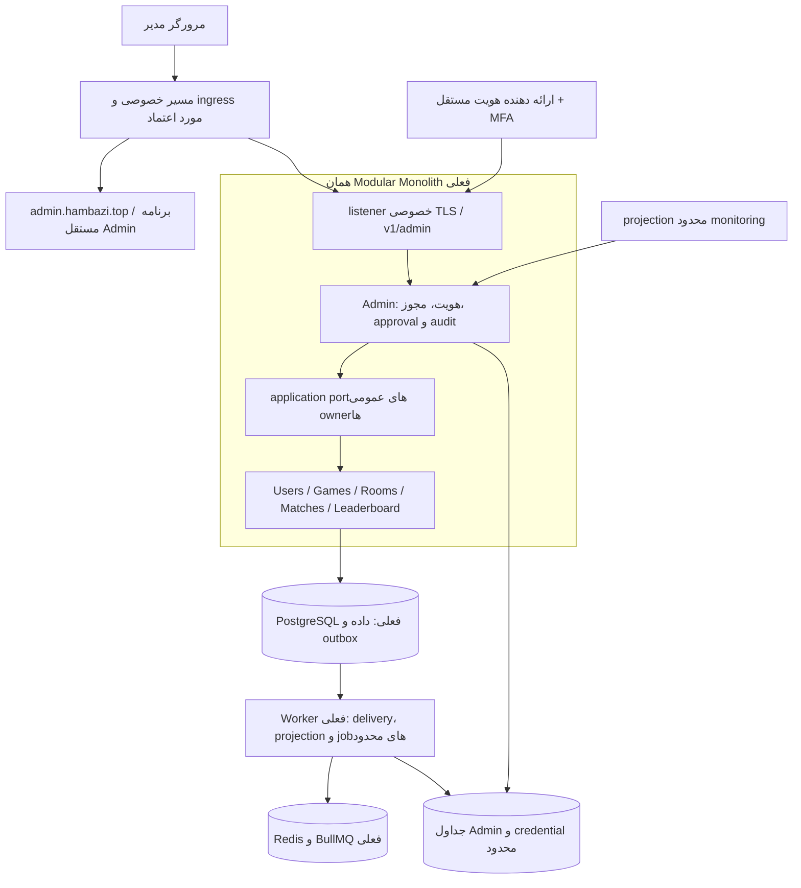

# معماری پیشنهادی Admin Dashboard هم‌بازی

> **تصمیم جدید مراسم Staging — [ADR-084](../adr/084-staging-owner-private-ssh-ceremony.md):** دو امضای Ed25519 و فایل credential خام برای Staging با پروفایل صریح SSH/root/TTY، تأیید عمل، checkpoint و Audit خصوصی جایگزین می‌شوند؛ Recovery به Password فعلی همان OWNER نیاز دارد. backup رمزگذاری‌شده و تمرین restore خارج سرور پیش‌نیازند. این تغییر محلی است؛ نصب، حساب واقعی، public ingress و فاز دو مجاز نشده‌اند. مطالب قبلیِ دو proof در این محدوده تاریخی‌اند؛ برای محیط‌های دیگر پابرجا هستند.

> **تصمیم جدید ۲۰۲۶-۱۰-۲۶ — [ADR-083](../adr/083-admin-public-https-and-self-credential-rotation.md):** مسیر استفادهٔ عادی، Public HTTPS با احراز هویت و Reverse Proxy محدود است؛ الزام SSH-only برای مرورگر منسوخ می‌شود. Backend/DB/Redis و Bootstrap/Recovery خصوصی می‌مانند. تغییر Password و PIN خود OWNER و ابطال نشست‌ها ادامهٔ محدود فاز یک‌اند. کد/تست محلی مجاز است؛ نصب سرور، Firewall، فعال‌سازی عمومی، حساب واقعی و فاز دو تأیید نشده‌اند. نصب فعلی سرور تا مجوز جدا همان SSH-only است. این یادداشت در موضوع ingress بر بندهای تاریخی پایین مقدم است.

> **بازنگری معتبر فاز یک — ۲۰۲۶-۱۰-۲۵:** [ADR-081](../adr/081-admin-local-password-and-owner-pin.md) تصمیم جدید و مرجع احراز هویت Admin است: ورود محلی Username/Password، مرحلهٔ PIN ثابت شش‌رقمی فقط برای OWNER، قفل دائمی پس از سه PIN اشتباه و بازیابی خصوصی با دو proof مستقل. Password + PIN ثابت **MFA مستقل یا مقاوم به فیشینگ نیست**. بندهای قبلی OIDC/IdP، MFA خارجی، ورود/دعوت بر اساس subject خارجی و بازیابی provider در این سند در محدودهٔ Admin منسوخ‌اند؛ اصل OWNER/RBAC/private ingress/audit و یکپارچگی بازی حفظ است. فاز یک با تأیید صریح مالک آغاز شده؛ [گزارش اجرایی فاز یک](../implementation/admin-dashboard-phase-1.md) دامنه و شواهد جاری را مشخص می‌کند. فاز دو، حساب واقعی و deployment مجوز ندارند. مطالب «فقط Markdown/فاز صفر» در بخش‌های قدیمی، سابقهٔ زمان تدوین‌اند.

تاریخ: ۲۰۲۶-۱۰-۲۵ — وضعیت: **جهت‌گیری معماری مبنای اجرای فازبندی‌شده؛ فاز صفر فقط بررسی و مستندات**. تصمیم‌های محیطی باز به معنی مجوز پیاده‌سازی یا استقرار نیستند.

بازنگری مدیریت دسترسی در همین تاریخ: مدل مالک و مدیران با درخواست صریح کاربر در [ADR-079](../adr/079-owner-and-admin-access-control.md) و [سند تفصیلی دسترسی](admin-access-control.md) بازطراحی شد. این دو مرجع در موضوع OWNER، role، approval و revocation بر پیشنهاد اولیهٔ این سند مقدم‌اند؛ سایر بخش‌های معماری همچنان پیشنهادی و اجرا‌نشده‌اند.

baseline فاز صفر: [گزارش و decision register](../implementation/admin-dashboard-phase-0.md)، [مدل تهدید](../security/admin-threat-model.md)، [قرارداد مفهومی](../contracts/admin-phase-0.md) و [ADR-080 دربارهٔ gate فازها](../adr/080-admin-phase-gates-and-phase-zero-baseline.md). طبق دستور جدید، پس از گزارش هر فاز توقف و برای فاز بعد تأیید صریح لازم است؛ هیچ مجوز اجرای پیوستهٔ تاریخی به این چرخه تعمیم نمی‌یابد.

مبنای بررسی: commit `9f3f7a31af77624d1b46e17e1bd390d8d7c33f43` و فایل‌های محلی مخزن. این سند مجوز پیاده‌سازی، ایجاد حساب مدیر، تغییر DNS، استقرار یا فعال‌سازی قابلیت عمومی نیست. هیچ وضعیت زنده‌ای در staging/production با اتصال به سرور بررسی نشده است؛ توصیف استقرار بر مبنای سوابق نسخه‌شده است. «موجود در کد»، «ثبت‌شده در سوابق استقرار» و «پیشنهاد آینده» در این سند معانی متفاوت دارند.

## ۱. تصمیم اصلی

یک برنامهٔ مستقل React در `apps/admin` برای `https://admin.hambazi.top`، با build و مسیر انتشار مستقل، ساخته شود. Backend آن یک ماژول در Modular Monolith فعلی و یک **listener خصوصی TLS مستقل** در `apps/api` باشد. PostgreSQL، Redis، Worker، قراردادها و application portهای موجود بازاستفاده شوند. در MVP سرویس دامنه، پایگاه‌داده، message broker یا backend عمومی جدید لازم نیست.

Origin مدیریتی، session، کلیدها، audience، نقش‌ها و سیاست مرورگر از Mini App مستقل‌اند. طبق ADR-083 درخواست‌های مرورگر به routeهای ضروری `/v1/admin/*` روی HTTPS عمومی همان origin می‌روند و Reverse Proxy با allowlist مسیر/متد، rate limit و هدر IP بازنویسی‌شده آن‌ها را به listener خصوصی مدیران هدایت می‌کند. Backend هیچ پورت عمومی ندارد و مسیرها روی API عمومی بازیکنان register نمی‌شوند. استفادهٔ عادی به VPN/SSH وابسته نیست؛ Bootstrap/Recovery همچنان SSH خصوصی می‌خواهند. نصب عمومی هنوز مجاز نشده است.

در MVP همان process API می‌تواند دو listener داشته باشد. این تصمیم هزینهٔ عملیات را کم می‌کند، اما **مرز حافظه، CPU یا مقابله با تسلط کامل مهاجم بر process ایجاد نمی‌کند**. quota و pool مستقل، کنترل بار هستند. اگر ارزیابی تهدید جداسازی سخت بخواهد یا اندازه‌گیری تداخل نشان دهد، قدم بعدی اجرای composition مدیران در process/container مستقل از همان کد و portهاست؛ افزودن RPC یا سرویس دامنهٔ مستقل به ADR بعدی نیاز دارد.

## ۲. نتیجهٔ بررسی وضع موجود

| بخش                | شاهد مخزن و وضعیت واقعی                                                                                              | استفادهٔ مجدد / شکاف                                                                                                    |
| ------------------ | -------------------------------------------------------------------------------------------------------------------- | ----------------------------------------------------------------------------------------------------------------------- |
| Monorepo           | `package.json`، pnpm Workspaces، Turbo، TypeScript؛ Node 24 و lockfile مشخص                                          | workspace جدید باید در قواعد معماری ثبت شود؛ داشتن پوشه به‌تنهایی کافی نیست                                             |
| Backend            | NestJS/Fastify؛ composition و ماژول‌های domain/application/infrastructure                                            | controller مدیران adapter است؛ قواعد در owner باقی می‌مانند                                                             |
| Admin              | `apps/api/src/admin/index.ts` فقط `export {}` دارد؛ ADR-039 و سند امنیت موجودند                                      | احراز هویت، RBAC، MFA، جدول audit و endpoint مدیریتی هنوز پیاده نشده‌اند                                                |
| احراز هویت بازیکن  | ADR-014، Auth، `sessions`؛ signed bearer کوتاه‌عمر، metadata پایدار و revocation، memory-only، بدون refresh          | تصمیم session بازیکن حل شده است؛ نباید برای مدیران reuse شود یا دوباره باز شود                                          |
| کاربران            | Users مالک حساب، پروفایل، eligibility و public names است                                                             | port جست‌وجوی مدیریتی، restriction و تاریخچهٔ اقدام لازم است؛ `status` موجود معادل سیستم moderation کامل نیست           |
| بازی‌ها            | catalog عمومی فعلی read-only و عمداً non-playable است؛ availability از runtime/admission نیز اثر می‌گیرد             | «کارت بازی»، «رکورد catalog»، «engine نصب‌شده» و «مجاز بودن پذیرش» باید جدا نمایش داده شوند                             |
| Engineها           | Coup و Kahroba، game-core، adapterها و pinهای نسخه در Match                                                          | پنل باید چندبازی باشد؛ schema عمومی catalog هنوز در برخی نقاط فقط Coup را می‌پذیرد؛ تعمیم آن پیش‌نیاز واقعی است         |
| اتاق و matchmaking | Rooms، صف Redis، reservation و arbitration پایدار در Matches، version و receipt                                      | diagnostics قابل استفاده است؛ فهرست مدیریتی، بستن اتاق و barrier نگه‌داری نیاز به port جدید دارند                       |
| Match              | `processing.ts` و repository: lock، expectedVersion، digest، receipt، event، outbox؛ lifecycle داخلی دارای TERMINATE | termination قابل reuse است، ولی trusted port فعلی admin auth/audit ندارد؛ اتصال مستقیم آن به HTTP ممنوع                 |
| بازی realtime      | Socket.IO، snapshot/catchup، seq، reconnect lease/epoch، timeout و bot takeover                                      | Admin subscriber بازیکن یا عضو ساختگی Match نشود؛ projection مستقل و پاک‌سازی‌شده لازم است                              |
| آمار               | `match_results` و `game_results` حقیقت پایدار؛ `stats_*` نسل‌دار و Worker                                            | از projection فعلی استفاده شود؛ `user_game_stats` foundation قدیمی، منبع داشبورد جدید نباشد                             |
| Redis/BullMQ       | rate limiting، صف، fanout، timeout، claim/retry و consumer dedupe                                                    | Redis منبع audit، session durable یا تنظیمات قطعی نباشد؛ namespace/ACL/بودجهٔ مدیران مستقل                              |
| Chat و پشتیبانی    | chat عضویت‌محور؛ `bot_support_submissions` و ارسال پشتیبانی بات وجود دارد                                            | سیستم گزارش تخلف، پرونده، mute و تیکت کامل وجود ندارد؛ پیام پشتیبانی بات معادل پروندهٔ تخلف نیست                        |
| پایگاه‌داده        | Prisma/PostgreSQL، scoped database helper، grants جدا برای API/Worker                                                | Admin هنوز database owner نیست؛ scope و credential آن باید اضافه شود؛ API موجود در سطح process به چند owner دسترسی دارد |
| Observability      | Pino allowlist، diagnostics، metrics خصوصی loopback، safe Sentry، dashboard/alert artifacts                          | UI فقط read model مجاز بگیرد؛ scraping مستقیم از مرورگر و proxy عمومی health ممنوع                                      |
| UI                 | React/Vite/TanStack Query/Zustand/Tailwind؛ Midnight، Vazirmatn و HamBazi Display                                    | رنگ‌ها و فونت reuse شوند؛ Telegram shell، عرض portrait و SDK وارد پنل نشوند                                             |
| استقرار            | Compose و nginx/Certbot روی host، شبکهٔ Docker خصوصی، TLS داده، images ثابت، containment/renewal                     | طبق سوابق، محیط restricted staging است؛ مسیر admin اکنون بسته است؛ هیچ ادعای production readiness وجود ندارد            |
| Bot/Cloudflare     | ADR-074 فعال‌شدن gateway حمل Telegram را در staging ثبت می‌کند                                                       | Cloudflare gateway فعلی IdP یا درگاه دسترسی Admin نیست؛ مالکیت حساب و بازی همچنان VPS است                               |
| CI                 | workflow، architecture gate، contract baseline، Vitest، Playwright و supply-chain scans                              | suite و baseline اختصاصی Admin باید در manifest/Turbo/CI ثبت شوند؛ امروز وجود ندارند                                    |

### تفاوت سند پایه با تصمیم‌های بعدی

- ADR-014 راهبرد session بازیکن را تعیین کرده است؛ عبارت «تصمیم باز» در سند اولیه نباید آخرین وضعیت تلقی شود.
- ADR-045 هدف اولیه را **۱۰۰۰ کاربر همزمان، ۲۰۰ Match فعال و ۵۰ فرمان بازی در ثانیه** تعیین کرده؛ فشار ۲ برابر، ۲۰۰۰/۴۰۰/۱۰۰ است.
- ADR-046 برای بار عادی p95 پاسخ REST و ack بازی حداکثر ۳۰۰ms، dispatch حداکثر ۵۰۰ms، موفقیت reconnect حداقل ۹۹٪ و p95 آن حداکثر ۵s را هدف قرار داده است.
- ADR-048 استثناهای عملکرد MVP را پذیرفته، نه تحقق ظرفیت production. پنل نمی‌تواند با استناد به پذیرش MVP، تست تداخل بار یا soak را حذف کند.
- `game-availability.md` بخشی از تاریخچهٔ قبل از rollout کهرباست؛ کد فعلی `kahrobaAdmitted` و اسناد جدیدتر کهربا را نیز دارد. برای تصمیم runtime باید منبع مؤثر و نسخهٔ آن نشان داده شود.
- `telegram-bot-runtime.md` هنوز توصیف تاریخی «prepared» دارد؛ ADR-074 و سوابق جدیدتر فعال‌شدن gateway را ثبت کرده‌اند. این اختلاف مستندی باید پیش از پیاده‌سازی در inventory فاز صفر تعیین تکلیف شود.

## ۳. معماری منطقی و استقرار



`AdminDB` و `PG` در شکل، مالکیت و credential متفاوت روی همان PostgreSQL هستند، نه دو دیتابیس الزامی. اتصال Worker به audit فقط از adapter/port مجاز با credential محدود audit انجام می‌شود؛ credential عمومی Worker حق تغییر audit نمی‌گیرد.

**Frontend:** React/Vite و TypeScript موجود، TanStack Query برای دادهٔ سرور، Zustand فقط برای state موقتی UI، Zod برای قراردادها و Tailwind برای layout. routing مستقل با URLهای پایدار؛ انتخاب کتابخانهٔ router/جدول/نمودار در فاز پیاده‌سازی پس از بررسی bundle، دسترس‌پذیری و سازگاری lockfile. افزودن SSR یا framework دوم توجیه ندارد.

**Backend:** ماژول Admin احراز هویت، مجوز، درخواست مدیریتی و audit را مالک است؛ Users محدودسازی حساب، Games تنظیمات بازی، Rooms چرخهٔ اتاق، Matches پایان اجباری و Leaderboard بازسازی آمار را مالک می‌مانند. Approval به owner یک context سرورساخته می‌دهد؛ `actorId`، role یا `mfa=true` از DTO قابل اعتماد نیست.

**انتشار:** asset مدیران build مستقل و cache immutable با نام hashدار؛ HTML و دادهٔ حساس بدون cache مشترک. می‌توان artifact جدا را در static ingress فعلی سرو کرد؛ container static جدید فقط اگر topology انتشار لازم بداند. Admin API پشت TLS خصوصی، مبدأ upstream محدود و کلیدهای مستقل؛ روی hostname بازیکن، bot webhook، مستقیم IP سرور و مسیر encoded مشابه، endpoint مدیریتی باز نشود. staging به origin، audience، کلید، namespace و حساب‌های مستقل نیاز دارد؛ hostname آن باید در inventory آینده تصویب شود.

**Monitoring:** در MVP از diagnostics عمومیِ ownerها و collection موجود، snapshot محدود و timestampدار ساخته شود. مقادیر بین portها اتمیک فرض نشوند. metrics loopback فعلی public نشود. برای تاریخچهٔ پایدار و uptime چندسرویسی، در فاز بعد collector خصوصی با مقصدهای ثابت بررسی شود؛ Docker socket، shell، URL دلخواه، Redis CLI، SQL console یا رابط عمومی BullMQ در پنل قرار نگیرد.

## ۴. مرزبندی و ساختار پیشنهادی

درخت زیر صرفاً طرح است؛ این فایل‌ها در این کار ساخته نشده‌اند.

```text
apps/admin/
  src/
    app/                 # shell، routeها، providerها
    platform/            # HTTP، session، قرارداد و خطای امن
    ui/                  # RTL، جدول، فرم، dialog و tokenهای ظاهری
    features/
      auth/ overview/ users/ games/ rooms/ matches/
      reports/ settings/ feature-flags/ monitoring/
      audit/ approvals/ operators/
  tests/                 # unit و browser
apps/api/src/admin/
  domain/                # capability، سیاست approval و چرخهٔ درخواست
  application/           # use case و repository/identity/monitoring ports
  infrastructure/
    http/ identity/ repositories/
  module.ts
  index.ts               # تنها surface عمومی
apps/api/src/composition/
  admin-http.ts          # listener و wiring؛ بدون rule کسب‌وکار
apps/worker/src/
  admin-outcomes.ts      # adapter مصرف outcome و reconciliation
packages/database/       # scope و مدل‌های owned؛ تغییر فقط در فاز اجرا
packages/config/         # config تایپ‌شده؛ اسرار و پارامترهای مصوب
docs/contracts/          # admin OpenAPI و baseline جدید
docs/operations/runbooks/# سناریوهای مصوب Admin
```

در MVP report workflow، settings عمومی و flag registry می‌توانند subdomainهای روشن داخل Admin باشند؛ وقتی مصرف‌کنندهٔ محصول یا چرخهٔ مستقل پیدا کردند، به ماژول مالک مشخص منتقل شوند. game availability از ابتدا مالک Games دارد. منطق محدودسازی حساب در Users و دسترسی به متن گفتگو در Chat می‌ماند.

تغییرات لازم قواعد معماری در فاز اجرا:

1. ثبت workspace `admin` و محدودکردن آن به قرارداد/validation/UI مجاز؛ ممنوعیت import دیتابیس، API server و engine.
2. اعمال قواعد feature public surface برای `apps/admin`؛ checker فعلی این بخش را مشخصاً برای `web` اعمال می‌کند.
3. افزودن `admin` به database owner و scope، بدون grant روی جدول‌های دیگر.
4. edge جدید `admin → leaderboard` برای خواندن آمار/درخواست rebuild باید صریح و با fixture مثبت/منفی تصویب شود. ماتریس فعلی فقط Users/Games/Rooms/Matches را اجازه می‌دهد.
5. دسترسی Auth برای revoke کردن session بازیکن و Chat برای evidence، اگر لازم شد، به ADR و public port مشخص نیاز دارند؛ dependency injection راه دورزدن مالکیت نیست.
6. استخراج tokenهای مشترک به `packages/ui` فقط هنگام وجود مصرف مشترک واقعی؛ تا آن زمان import مستقیم CSS داخلی `apps/web` مجاز نیست. قرارداد Admin نیز می‌تواند surface مشخصی در قراردادهای موجود داشته باشد؛ shared محل rule مدیریتی نیست.

## ۵. API پیشنهادی

تمام موارد این جدول **قرارداد آینده** هستند، نه endpoint موجود. schemaها strict، نسخه‌دار و با baseline مستقل باشند. در MVP REST و polling محدود کافی است؛ صفحهٔ مخفی polling ندارد، خطا backoff دارد و دادهٔ کهنه مشخص می‌شود. Socket بازی برای Admin reuse نمی‌شود.

| گروه       | نمونهٔ مسیر زیر `/v1/admin`                                                       | semantics                                                                |
| ---------- | --------------------------------------------------------------------------------- | ------------------------------------------------------------------------ |
| ورود       | `/auth/login`، `/auth/callback`، `/session`، `/auth/logout`                       | ورود IdP، session مستقل، خروج revoke؛ callback فقط مسیر OIDC مشخص        |
| overview   | `GET /overview`                                                                   | KPI موجود با `asOf`، validity، freshness و scope محیط                    |
| کاربران    | `GET /users`، `GET /users/:id`                                                    | جست‌وجوی محدود، allowlist فیلد و cursor؛ بدون export عمومی               |
| حساب       | `POST /users/:id/restrictions`                                                    | محدودیت مشخص، reasonCode، expiry اختیاری و version؛ نه PATCH دلخواه User |
| بازی       | `GET /games`، `POST /games/:id/availability-changes`                              | desired/effective state، revision و readiness                            |
| اتاق       | `GET /rooms`، `POST /rooms/:id/closure-requests`                                  | بستن pre-start با guard؛ اتاق STARTED با حذف رکورد بسته نمی‌شود          |
| Match      | `GET /matches`، `GET /matches/:id`، `POST /matches/:id/termination-requests`      | metadata مجاز، pins، وضعیت اتصال و عملیات تک‌هدفه                        |
| گزارش      | `GET /reports`، `POST /reports/:id/decisions`                                     | پرونده و state transition محدود؛ مسیر ثبت گزارش بازیکن dependency جداست  |
| تنظیمات    | `GET /settings`، `POST /settings/:key/change-requests`                            | فقط keyهای ثبت‌شده و non-secret با schema، scope و revision              |
| flags      | `GET /feature-flags`، `POST /feature-flags/:key/change-requests`                  | registry مشخص، ارزیابی سمت سرور، expiry و تاریخچه                        |
| عملیات     | `GET /operations/:id`، `POST /operations/:id/approvals`                           | مشاهدهٔ نتیجهٔ نامعلوم/درحال‌انجام؛ approval از اجرای اثر جداست          |
| آمار       | `POST /statistics/rebuild-requests`                                               | job محدود و نسل‌دار؛ HTTP تا پایان rebuild باز نمی‌ماند                  |
| امنیت      | `GET /audit-events`، `GET /operators`، دعوت/نقش/override/session و owner-decision | مدیریت دسترسی فقط OWNER؛ جزئیات قرارداد در سند دسترسی                    |
| مانیتورینگ | `GET /monitoring/summary`                                                         | projection امن؛ endpoint دلخواه برای proxy کردن وجود ندارد               |

فرمان مدیریتی: `schemaVersion`، `commandId`، revision/version مورد انتظار، `reasonCode` و payload خاص همان operation. Target از route با body تطبیق داده شود. در صورت پشتیبانی از `Idempotency-Key` باید برابر `commandId` باشد؛ دو شناسهٔ متناقض پذیرفته نشود. هویت با actor و digest ورودی‌های نرمال‌شده پیوند می‌خورد؛ استفادهٔ مجدد با payload متفاوت conflict است.

پاسخ commit قطعی می‌تواند 200 باشد؛ approval/job یا اثر چندمرحله‌ای 202 همراه `operationId` و وضعیت `PENDING` می‌دهد. 202 معادل اعمال تغییر نیست. timeout نتیجه را `UNKNOWN/RECONCILING` می‌کند؛ retry با شناسهٔ جدید انجام نمی‌شود. خطاهای جدید مانند `ADMIN_STEP_UP_REQUIRED`، `ADMIN_APPROVAL_REQUIRED`، `ADMIN_AUDIT_UNAVAILABLE` و `ADMIN_REVISION_CONFLICT` فقط پس از تعریف schema/baseline اضافه شوند. UI بر error code شرط می‌گذارد.

فهرست‌ها keyset pagination با sortهای محدود، page size سقف‌دار و بازهٔ زمانی محدود داشته باشند. شمارش دقیق کل نتایج پیش‌فرض نباشد. query SQL، sort expression، URL، اسم handler و JSON تنظیمات دلخواه دریافت نشود. `Cache-Control: no-store` برای پاسخ‌های شخصی/مدیریتی؛ شناسه‌های عددی بزرگ و countها مطابق آمار فعلی decimal string باشند.

## ۶. هویت و امنیت مدیران

### ۶.۱ ورود و نشست محلی مصوب ADR-081

یک صفحهٔ فارسی Username/Password برای همه؛ بدون Signup یا بازیابی عمومی. مدیر عادی پس از password معتبر نشست FULL می‌گیرد. OWNER فقط از binding حفاظت‌شده تشخیص داده می‌شود و ابتدا cookie موقت PENDING بدون authority می‌گیرد؛ سپس PIN ثابت شش رقم ASCII بررسی می‌شود. خطای username/password عمومی است و مرحلهٔ PIN را باز نمی‌کند. PIN ثابت همراه password دو knowledge secret هستند؛ MFA مستقل یا مقاوم به فیشینگ نیستند.

Password و PIN، verifier و salt مستقل Argon2id دارند؛ PIN پیش از Argon2 با HMAC/pepper خارج DB تقویت می‌شود. credential خام، verifier، token و cookie وارد log، audit، response یا storage مرورگر نمی‌شوند. نگه‌داری verifier محدود به جداول امنیتی Admin است و session بازیکنان تغییر نمی‌کند.

شمارندهٔ PIN فقط پس از password صحیح، در PostgreSQL و زیر lock پایدار به‌روزرسانی می‌شود. سومین failure قفل دائمی و افزایش sessionEpoch ایجاد می‌کند؛ login دوباره، IP/browser، زمان یا restart آن را باز نمی‌کنند. retry همان commandId یک تلاش است؛ موفقیت کامل پیش از lock شمارنده را صفر می‌کند. recovery خصوصی همان OWNER را حفظ و با PIN جدید تمام نشست‌های قبلی را باطل می‌کند.

Cookieهای `__Host-hambazi-admin` و `__Host-hambazi-admin-pending` با Secure/HttpOnly/SameSite=Strict/Path=/ و بدون Domain، نوع و audience/key مستقل دارند. هر mutation به Origin دقیق، JSON و CSRF متصل به همان نشست نیاز دارد. session metadata/epoch/status/credentialVersion و scope در primary بررسی می‌شوند؛ JWT هیچ role/grant قابل اتکایی حمل نمی‌کند. مرورگر دسترسی را هر پنج ثانیه در foreground و هنگام بازگشت tab بررسی می‌کند؛ polling زمان idle را تمدید نمی‌کند.

زمان absolute/idle/pending، private peers، کلیدها و بودجهٔ KDF/pool همگی تنظیم صریح هستند؛ مقدار production از fixture برداشت نمی‌شود. entry point اختیاری جدا از همان کد API، TLS خصوصی و credential/pool محدود دارد تا هزینهٔ KDF به event loop بازی تحمیل نشود. هیچ reverse proxy، DNS، سرویس سرور یا استقراری در فاز یک تغییر نکرده است.

### ۶.۲ شبکه و browser

شبکهٔ خصوصی و احراز هویت انسانی دو شرط مستقل‌اند. Origin API از اینترنت مستقیم قابل دسترسی نباشد؛ ingress باید headerهای هویت/forwarding ارسالی client را پاک کند. peerها محدود و در صورت استفاده از mTLS، certificate واقعاً اعتبارسنجی شود. Cloudflare یا VPN خاصی بدون تصمیم provider قطعی فرض نشود.

CSP محدود به منابع لازم، `frame-ancestors 'none'`، framing denied، HSTS، nosniff، referrer محدود و asset/font محلی. policy Mini App که embedding تلگرام را می‌پذیرد برای Admin کپی نشود. هیچ session replay، raw error capture یا analytics ثالث حاوی دادهٔ مدیریتی فعال نباشد. CSP متناسب با SPA build انتخاب شود و برای راحتی توسعه `unsafe-eval` به production راه نیابد.

هویت/authorization/session/audit admission که قابل تأیید نیستند، اجازهٔ mutation نمی‌دهند. افت IdP در مسیر عادی fail closed است؛ مسیر emergency فقط با authenticator مستقل از پیش enrolled و policy محدود ADR-079 می‌تواند هویت را مستقل تأیید کند. افت Redis باعث bypass rate limit نشود؛ read تشخیصی محدود فقط در سیاست degrade از پیش مصوب ممکن است و authorization فعلی primary همچنان لازم است. revoke/logout باید با PostgreSQL امکان‌پذیر بماند. قطع Admin/IdP نباید readiness بازی را صرفاً به دلیل اختیاری‌بودن Admin پایین بیاورد.

### ۶.۳ مدل RBAC و scope

مدل بازنگری‌شده: **OWNER محافظت‌شده + Role-Based و Fine-Grained Permissions برای سایر مدیران**. OWNER از root binding یکتای server-side شناخته می‌شود و به تمام permissionهای ثبت‌شدهٔ فعلی و آینده دسترسی دارد. او تابع deny/scope نقش‌های عادی نیست، اما auth/MFA/network/audit، data policy و invariant دامنه همچنان بر او اعمال می‌شوند. permission ناشناخته برای همه رد می‌شود. هیچ role، DTO یا claim با نام OWNER مالک ایجاد نمی‌کند.

| نقش                          | مدل دسترسی                                                             | مدیریت دسترسی دیگران                                                          |
| ---------------------------- | ---------------------------------------------------------------------- | ----------------------------------------------------------------------------- |
| OWNER                        | تمام capabilityهای معتبر فعلی/آینده؛ تصمیم نهایی مالک برای عملیات حساس | دعوت/ایجاد/فعال/غیرفعال/tombstone، نقش سفارشی، assignment، override و نشست‌ها |
| Super Admin                  | مجموعهٔ وسیع ولی صریح و scoped از قابلیت‌های محصول                     | بدون role CRUD یا تغییر مالک؛ permission آینده خودکار نمی‌گیرد                |
| Moderator                    | پرونده/محدودسازی در scope و policy مصوب                                | ندارد                                                                         |
| Support                      | خواندن پایه و workflow پشتیبانی مجاز                                   | ندارد                                                                         |
| Operator                     | monitoring و عملیات بازی/اتاق/Match صریح                               | ندارد                                                                         |
| سفارشی / ممیز / اپراتور آمار | ترکیب permissionهای قابل واگذاری توسط مالک                             | قابلیت‌های OWNER_ONLY قابل grant نیستند                                       |

پنج سطح view/create/edit/manage/approve مستقل‌اند؛ manage به معنی approve نیست. نقش‌ها templateهای explicit و قابل clone/ویرایش توسط مالک‌اند. هر مدیر role assignment و ALLOW/DENY فردی با scope محیط/بازی/بخش دارد؛ deny منطبق برای غیرمالک بر allow غالب است. backend در read/mutation/retry/job مجوز فعلی را از primary و revision معتبر بررسی می‌کند؛ تغییر نشست فعال حداکثر در ۵s اتصال را invalidate/قطع می‌کند و gateهای جدید بعد commit حق stale authorization ندارند. UI فقط projection این تصمیم است. [OWASP Authorization](https://cheatsheetseries.owasp.org/cheatsheets/Authorization_Cheat_Sheet.html)

هیچ مدیر دیگری حتی Super Admin حق حذف، مسدودسازی، تنزل، تغییر binding یا ابطال نشست OWNER را ندارد. خود مالک نیز root را با CRUD عادی حذف نمی‌کند. bootstrap خصوصی identity-bound و recovery همان root، بدون hardcode، در سند تفصیلی آمده است. OWNER_FINAL با reauthentication تازه، reason، binding یک‌بارمصرف و audit جای شرط دو نفر را برای مالک می‌گیرد؛ self-approval مدیر عادی همچنان ممنوع است. Break-glass مسیر محدود رخداد/اختلال هویت است، نه شرط کار مالک یگانه.

## ۷. مدل داده و مالکیت

تمام جدول‌های این بخش **مدل مفهومی پیشنهادی** هستند؛ هیچ migration یا schema اجرا نشده است.

| مالک                     | دادهٔ جدید پیشنهادی                                                               | قیود اصلی                                                                                                                              |
| ------------------------ | --------------------------------------------------------------------------------- | -------------------------------------------------------------------------------------------------------------------------------------- |
| Admin                    | `admin_owner_binding`، bootstrap/recovery metadata                                | singleton realm، ownershipEpoch، immutable از CRUD عادی؛ identity از ceremony خصوصی                                                    |
| Admin                    | `admin_operators`، `admin_roles`، `admin_role_permissions`، `admin_role_bindings` | unique issuer/subject، template/revision، scope، status و authorizationVersion؛ OWNER نقش قابل assignment نیست                         |
| Admin                    | `admin_permission_overrides`، `admin_policy_head`، `admin_invitations`            | ALLOW/DENY فردی، revision مشترک، دعوت identity-bound بدون bearer ذخیره‌شده                                                             |
| Admin                    | `admin_sessions`                                                                  | metadata، assurance/auth time، expiry/revocation، sessionEpoch، normal/emergency؛ بدون credential خام                                  |
| Admin                    | `admin_operations`                                                                | actor، commandId، digest، target، expectedVersion، وضعیت workflow؛ unique actor/commandId                                              |
| Admin                    | `admin_approvals`، `admin_decision_challenges`                                    | DUAL_CONTROL یا OWNER_FINAL/OWNER_EMERGENCY؛ operation/digest/revision/policy/epoch binding، expiry؛ رد self-approval غیرمالک و replay |
| Admin                    | `admin_audit_events`                                                              | append-only، eventId یکتا، operationId، capability، target، version، reason/outcome code و server time                                 |
| Admin در MVP             | `moderation_reports`، `moderation_case_events`                                    | reference به reporter/subject/Match/message، دسته و وضعیت؛ evidence خام وارد audit نشود                                                |
| Users                    | `user_restrictions` و receipt/outcome مربوط                                       | نوع/دامنه/شروع/پایان محدودیت، version و idempotency؛ نه فقط تبدیل status با SQL                                                        |
| Games                    | revision تنظیمات و تاریخچهٔ availability                                          | schema و revision صریح، تغییر CAS؛ `updatedAt` جای revision نیست                                                                       |
| ownerهای پذیرش           | metadata barrier پذیرش در صورت نیاز                                               | epoch و desired/effective revision؛ مالکیت جدا برای gate اتاق و Match                                                                  |
| Admin برای کلیدهای عمومی | `platform_setting_revisions`، `feature_flag_revisions`                            | key ثبت‌شده، schema، environment/scope، revision و expiry؛ secret ذخیره نشود                                                           |
| ownerهای فعلی            | receipt و outcome outbox برای تغییرات مدیریتی                                     | اثر + receipt + outcome در یک transaction مالک                                                                                         |
| آمار در فاز رشد          | projection روزانهٔ موردنیاز                                                       | ساخته‌شده از event/port نسخه‌دار؛ بدون دسترسی Admin به state بازی                                                                      |

همان PostgreSQL کافی است. table prefix و scopeهای database helper مرز منطقی را روشن می‌کنند. credentialهای identity/workflow و audit حداقل دسترسی لازم داشته باشند؛ audit writer فقط INSERT و reader فقط SELECT محدود، بدون UPDATE/DELETE/TRUNCATE؛ triggerهای append-only با runtime role واقعی تست شوند. migration owner از runtime جداست. رمزدار بودن storage زیرساخت جای field minimization را نمی‌گیرد.

DB role مدیر نباید SELECT روی `matches.state_jsonb`، `game_events.payload_jsonb`، chat یا جدول‌های Auth بازیکن بگیرد. ownerهای Users/Matches تنها projection خاص Admin را برمی‌گردانند. admin credential کم‌اختیار به‌تنهایی جلوی استفاده از credential دیگری در process کاملاً compromise‌شده را نمی‌گیرد؛ جداسازی process در threat review بررسی می‌شود.

Indexهای اولیه فقط مطابق query: audit بر `(occurredAt,id)`، `(targetKind,targetId,occurredAt,id)` و operationId؛ operation بر actor/commandId و status/createdAt؛ پرونده بر status/createdAt/id؛ restriction بر user/scope/expiry. indexهای ثانویه، partition و read replica با EXPLAIN/اندازه‌گیری و رشد واقعی اضافه شوند.

نگه‌داری audit، پرونده، session metadata، export و evidence تابع تصمیم retention مستقل و OD-005 است. append-only به معنای نگه‌داری ابدی نیست؛ retention فقط با هویت maintenance جدا، مجوز مصوب و evidence انجام می‌شود. purge در UI مدیر روزمره وجود ندارد. migration آینده additive با expand → backfill → contract و حداقل یک release overlap باشد.

## ۸. پروتکل ایمن عملیات و Audit

مطابق ADR-039، ثبت audit پس از موفقیت به‌تنهایی کافی نیست:

1. schema/حدود ورودی، شبکه، session، capability، MFA، scope و revision بررسی شوند. preview پاک‌سازی‌شدهٔ تغییر و پیامد آن ساخته شود.
2. approval به **عمل مشخص، target، digest، نسخه و policy** متصل شود؛ تغییر هر کدام approval را نامعتبر می‌کند. برای غیرمالک DUAL_CONTROL و برای مالک OWNER_FINAL با reauth تازه و دلیل صریح وجود دارد؛ mode و ownershipEpoch در audit مشخص‌اند. profile زمان و recovery در ADR-079 آمده است. تأیید یک صفحه مجوز همهٔ درخواست‌های بعدی نیست. [OWASP Transaction Authorization](https://cheatsheetseries.owasp.org/cheatsheets/Transaction_Authorization_Cheat_Sheet.html)
3. قبل از فراخوانی owner، admission audit پایدار ثبت شود. شکست audit = صفر اثر در owner. قبل از احراز هویت، floodها فقط counter محدود تولید کنند.
4. owner با context سرورساخته و شناسهٔ اصلی، state/revision و readiness را مجدداً کنترل کند؛ effect، receipt و outcome outbox در transaction کوتاه خود commit شوند. هیچ تماس IdP، شبکه یا Telegram داخل transaction انجام نشود.
5. نتیجهٔ commit با metadata امن به UI برگردد؛ outcome audit با مصرف idempotent outbox تکمیل شود. `eventId` یکتا مانع ثبت تکراری است؛ admission و outcome رکوردهای جدا و immutable هستند.
6. crash میان admission و owner یا میان commit و audit با receipt/outbox همان owner reconcile شود. تا اثبات، وضعیت `UNKNOWN/RECONCILING` باقی بماند. درخواست تازه با commandId جدید یا direct SQL راه بازیابی نیست.
7. retry نیز به مجوز فعلی نیاز دارد. revoke، تغییر role یا step-up منقضی می‌تواند retry را رد کند؛ reconciliation داخلیِ نتیجهٔ قبلاً commit‌شده فقط ثبت نتیجه است و اجازهٔ اجرای اثر جدید ندارد.

ثبت audit شامل subject opaque، operation/event ID، capability، target، expected/result version، codeهای ثابت، policy/assurance identifier و correlation امن است. token، assertion، hash credential، initData، seed، کارت، متن chat، body یا raw error ثبت نشوند. مقدار قبل/بعد فقط برای تنظیمات non-secret و allowlisted؛ برای سایر داده‌ها reference و revision کافی است. مشاهدهٔ PII/evidence و export احتمالی هم audit دسترسی می‌خواهد.

### سیاست عملیات حساس و Rollback

| عملیات                    | تأیید و guard                                                      | اثر بر بازی فعال                                         | جبران / Rollback                                                                                  |
| ------------------------- | ------------------------------------------------------------------ | -------------------------------------------------------- | ------------------------------------------------------------------------------------------------- |
| مشاهدهٔ metadata          | RBAC و scope                                                       | ندارد                                                    | لازم نیست                                                                                         |
| تغییر تنظیم کم‌خطر        | step-up، reason، CAS                                               | فقط scope اعلام‌شده                                      | فرمان جدید برای مقدار قبلی با revision جدید                                                       |
| توقف پذیرش بازی           | preview اثر، step-up، approval طبق incident policy                 | Matchهای پذیرفته‌شده ادامه می‌یابند                      | بازگشایی فقط پس از readiness و تأیید جدید                                                         |
| فعال‌سازی بازی/flag پرخطر | دو فرد متمایز یا OWNER_FINAL؛ readiness و rollout gate             | فقط Match جدید؛ pinهای فعال ثابت                         | بازگرداندن admission؛ تغییر engine فعال ممنوع                                                     |
| بستن اتاق                 | current version، host/member race guard، reason                    | فقط قبل از start؛ پس از start مسیر Match                 | بازکردن خودکار/بازسازی عضویت تضمین ندارد؛ اتاق تازه در صورت مجازبودن                              |
| محدودسازی حساب            | reason، scope/expiry، version؛ اقدام پرخطر approval                | قطع دسترسی طبق policy مصوب؛ صندلی و کارت دستکاری نمی‌شود | رفع محدودیت با فرمان جدید؛ session revoked دوباره زنده نمی‌شود                                    |
| TERMINATE یک Match        | دو فرد یا OWNER_FINAL؛ step-up تازه، target و expectedVersion دقیق | پایان غیرقابل بازگشت؛ بدون آمار برد/تکمیل                | **Undo ندارد**؛ history/result جعلی یا بازگرداندن snapshot ممنوع                                  |
| rebuild آمار              | approval، generation/command ثابت، یک build فعال                   | job پس‌زمینهٔ محدود                                      | قبل cutover abort و حفظ active؛ بعد cutover rebuild اصلاحی؛ pointer به نسل کهنه کورکورانه برنگردد |
| deploy/restore/secret     | خارج از UI MVP                                                     | وابسته به runbook                                        | فقط workflow عملیات موجود با نسخه‌های compatible؛ destructive down migration ممنوع                |

پنل دکمهٔ force-win، تغییر coin/card/deck، بازنویسی event، کاهش stateVersion، تعویض engine Match فعال، reclaim بعد Bot takeover یا bulk terminate ندارد. Engineهای فعلی pause/resume عمومی مصوب ندارند؛ در MVP پیشنهاد نمی‌شود.

### مرز دقیق maintenance و پذیرش

Toggle ظاهری یا cache کافی نیست. وضعیت به `REQUESTED/APPLYING/EFFECTIVE/FAILED` تفکیک شود. desired revision در Games و gate مؤثر در ownerهای پذیرش تعریف شود. هر owner تغییر gate را با همان serialization مسیر create/start/commit خود اعمال می‌کند؛ reservationهای هنوز commitنشده با epoch قدیمی باید هنگام commit مجدداً guard شوند. برای اتاق و Match، تغییر مؤثر مستقل گزارش می‌شود؛ تا تأیید همهٔ gateهای لازم، UI «maintenance کامل شد» نمی‌گوید.

Matches/Rooms جدول owner دیگر را query نمی‌کنند؛ coordination از application port و outcome نسخه‌دار با بازیابی durable انجام می‌شود. lock/transaction محلی بدون network I/O و بدون distributed transaction است. یک admission قبل از barrier commit می‌شود و معتبر می‌ماند، یا بعد از آن رد می‌شود؛ تست رقابت این نقطه را اثبات می‌کند. metadata gate و پروتکل بین ownerها **قابلیت جدید موردنیاز** هستند؛ config boolean موجود این ضمانت سراسری را ندارد. اگر این پروتکل در فاز MVP mutation تکمیل نشد، کلید maintenance همچنان read-only می‌ماند.

### محدودسازی کاربر و محتوای گزارش

محدودیت ورود/بازی جدید با قطع session یا mute یکسان نیست. Users مالک eligibility است؛ Auth و Realtime باید تغییر را در درخواست و delivery بعدی اعمال کنند. action از قبل پذیرفته‌شده عقبگرد نمی‌کند؛ برای revoke سراسری فوری، port و event مشخص با تست چند node لازم است. رفتار صندلی فعال با reconnect/timeout موجود انجام می‌شود؛ تصمیم اثر ban بر بازی جاری در ADR moderation ثبت شود.

ADR-039 فعلی دسترسی Admin به متن chat را مجاز نکرده است. MVP می‌تواند **metadata پرونده، reference پیام و triage** داشته باشد؛ رسیدگی محتوایی تا تصمیم OD-005 و ADR تکمیلی متوقف می‌ماند. پس از تصویب، Chat فقط context محدود همان پرونده را از port مجاز، با purpose، permission مستقل، masking و audit دسترسی ارائه می‌کند؛ متن وارد audit/telemetry/Redis job نمی‌شود. این توسعه باید استثنای محدود و صریح ADR-039 باشد، نه نادیده‌گرفتن آن. ثبت گزارش توسط بازیکن، مقابله با گزارش تکراری/آزارگرانه، appeal، mute و retention نیاز به طراحی قراردادی جدا دارند.

## ۹. تنظیمات و Feature Flags

سه نوع تنظیم جدا نمایش داده شود:

| نوع              | نمونه                                                           | اختیار پنل                                         |
| ---------------- | --------------------------------------------------------------- | -------------------------------------------------- |
| کسب‌وکار runtime | پذیرش بازی، قابلیت کم‌خطر UI، پیام maintenance                  | فقط registry تایپ‌شده با revision و approval       |
| pinned در Match  | engine/state/ruleset/reconnect policy                           | نمایش؛ تغییر فقط برای Match جدید با rollout مصوب   |
| زیرساخت/امنیت    | DB URL، secret، trusted proxy، session bounds، scan expiry، TLS | خارج از editor پنل؛ فقط metadata غیرحساس و runbook |

هر flag مالک، environment، scope، مقدار پیش‌فرض امن، schemaVersion، revision، زمان اعتبار و دلیل دارد. game admission همیشه Games/ownerهای پذیرش را enforce می‌کند؛ frontend flag مجوز نمی‌دهد. تنظیمات محیطی سخت‌گیرانه و محدودیت staging سقف اختیارند؛ Admin حق بازکردن owner admission یا production HOLD را با flag ندارد.

در MVP flags ساده و backend-side؛ موتور rule عمومی و کد قابل اجرا وجود ندارد. rollout درصدی در فاز رشد با bucketing پایدار، audit و metric مشخص اضافه شود. flag اثرگذار بر قواعد باید در زمان ساخت Match pin شود. rollback یعنی revision جدید با مقدار قبلی، نه حذف تاریخچه. cache فقط optimization است؛ admission حساس به cache کهنه اعتماد نکند. dashboard باید منبع مقدار، desired/effective revision و override محیطی را نشان دهد.

## ۱۰. صفحات و تجربهٔ کاربری فارسی

Layout دسکتاپ با sidebar سمت راست، نوار بالای محیط/هویت/وضعیت امنیتی، breadcrumb و محتوای جدول‌محور؛ موبایل با drawer و کارت‌های فشرده. هر صفحه loading، empty، forbidden، stale، degraded و error واقعی دارد. صفحهٔ اصلی با وضعیت سرویس و تازه‌بودن داده شروع می‌شود؛ metric ناموجود با «داده موجود نیست» نمایش داده شود، نه صفر یا عدد تزئینی لابی.

| صفحه          | محتوای مفهومی                                                                                     | جریان اصلی                                                                |
| ------------- | ------------------------------------------------------------------------------------------------- | ------------------------------------------------------------------------- |
| نمای کلی      | Match/Room برحسب status، صف/lag، خطا، آمار تکمیل، سلامت collection                                | انتخاب KPI → فهرست با filter یکسان                                        |
| کاربران       | جست‌وجوی ID/handle، وضعیت، تاریخ عضویت، restriction، آمار مجاز                                    | انتخاب → خلاصه → درخواست اقدام با scope و reason                          |
| بازی‌ها       | engine نصب‌شده، capability، availability، readiness، pins، اثر تغییر                              | preview تغییر → تأیید → desired/effective state                           |
| اتاق‌ها       | game/mode، ظرفیت، وضعیت، سن اتاق، version                                                         | بررسی اتاق → بستن pre-start؛ invite code پیش‌فرض پنهان                    |
| Matchها       | game/type، وضعیت، version/seq، اتصال‌ها، pins و timeline امن                                      | بررسی اختلال → درخواست termination → approval → نتیجه                     |
| گزارش تخلف    | صف پرونده، دسته، اولویت، assignee و history تصمیم                                                 | triage → بررسی مجاز → تصمیم/رد/ارجاع؛ بدون محتوای chat در فاز اولیه       |
| تنظیمات/flags | registry دسته‌بندی‌شده، scope، revision، expiry و تغییرات                                         | preview تفاوت → تأیید → وضعیت اعمال                                       |
| مانیتورینگ    | سلامت، pool pressure، outbox/queue، latency، خطای collection                                      | علامت رخداد → runbook؛ بدون restart یا terminal                           |
| approvals     | درخواست، پیامد، دلیل، نسخه، درخواست‌کننده و انقضا                                                 | تأییدکنندهٔ مستقل یا OWNER_FINAL → reauth → تصمیم ثبت‌شده                 |
| audit         | فیلتر زمان/actor/target/outcome و operation timeline                                              | admission → owner commit → outcome؛ عدم تطبیق برجسته                      |
| مدیران        | root badge، مدیران/دعوت‌ها، نقش سفارشی، ماتریس پنج‌سطحی و effective permission، session و history | فقط مالک: preview → reason/reauth → تغییر نسخه‌دار؛ بدون نمایش credential |

**هویت Midnight Neon:** زمینهٔ سرمه‌ای بسیار تیره با پایه‌های موجود `#030b20` و `#07152c`، متن روشن `#edf1fa`، accent طلایی `#edc46c` و cyan/violet محدود برای focus و وضعیت. نئون برای تأکید، نه glow روی تمام جدول. Vazirmatn برای متن/اعداد و فونت نمایشی فقط عنوان کوتاه. assets موجود فقط پس از کنترل مجوز و نیاز واقعی؛ داشبورد به تصویر تولیدی جدید نیاز ندارد.

`lang=fa` و `dir=rtl` در root؛ CSS logical properties؛ ID، URL، کد و زمان فنی با `bdi`/LTR ایزوله. timestamp ذخیره/API UTC، نمایش پیش‌فرض Asia/Tehran با timezone واضح؛ تبدیل تقویم فقط presentation است و هفتهٔ آماری فعلی Monday UTC تغییر نمی‌کند. جست‌وجوی شناسه باید رقم فارسی و لاتین را با normalization مشخص مدیریت کند.

دسترسی keyboard، focus قابل رؤیت، نام accessible برای icon، متن همراه رنگ، کاهش motion و zoom لحاظ شود. هدف پیشنهادی پذیرش UI سطح AA با contrast متن معمولی حداقل ۴٫۵:۱ است. جدول در موبایل ستون‌های مهم را نگه دارد و جزئیات در صفحه/پنل باز شود؛ dialog حساس جزئیات عمل و برگشت‌پذیری را آشکار کند. دکمهٔ خطر پیش‌فرض focus/submit نباشد و optimistic update برای عملیات حساس استفاده نشود.

سه جریان کلیدی:

1. **ورود:** private access → IdP/MFA → session مستقل → capabilityها → overview؛ خطای MFA/شبکه دسترسی محدود ایجاد نمی‌کند.
2. **تغییر بازی:** انتخاب scope → خواندن revision/readiness → preview → step-up → admission audit → owner effect → تأیید effective؛ تعارض نسخه دوباره preview می‌خواهد.
3. **Match معیوب:** metadata و علت → انتخاب یک Match → هشدار پایان غیرقابل بازگشت → تأیید مستقل یا تصمیم نهایی مالک با reauth → اجرای guarded → نمایش receipt/outcome؛ قطع شبکه حالت نامعلوم و بازیابی همان operation را نشان می‌دهد.

## ۱۱. اثر بر عملکرد و مقیاس‌پذیری

- API Admin بودجهٔ concurrency، rate limit و body/query/page سقف‌دار مستقل دارد. pool محدود برای خواندن مدیریتی و audit؛ مجموع poolها در همهٔ replicaها با ظرفیت PostgreSQL سنجیده شود. pool جدا، CPU/IO مشترک DB را حذف نمی‌کند.
- خواندن‌ها بدون lock نوشتن و با projection/index مشخص؛ `state_jsonb` یا event payload برای لیست‌ها load نشود. dashboard summary از metric/projection موجود، نه full scan در هر refresh.
- timeout واقعی statement/lock و cancellation برای queryهای مدیریتی بررسی شود؛ timeout Promise به‌تنهایی query PostgreSQL را متوقف نمی‌کند. query بدون سقف و COUNT کامل بهینه‌نشده gate پذیرش را رد کند.
- cache summary کوتاه‌عمر و bounded/coalesced؛ data freshness در UI. دادهٔ stale برای chart قابل نمایش با برچسب است، برای approval/precondition معتبر نیست.
- شناسهٔ user/match/operation label متریک نشود. جمع connected-users چند node برابر CCU یکتا نیست؛ تا تعریف global presence، عدد با عنوان دقیق «node-local/غیریکتا» یا ناموجود نمایش داده شود.
- KPIهای DAU، retention، revenue و نرخ برد کل بدون definition/source نمایش داده نشوند؛ آمار فعلی بازی‌های پایان‌یافته، رخداد محصول همهٔ user activityها نیست.
- rebuild/report/export در Worker با queue و concurrency محدود، priority منابع gameplay و امکان pause پذیرش job جدید. CPU سنگین نباید event loop timeout/reconnect را ببندد؛ در صورت نیاز worker composition جدا از همان image، قبل از گسترش قابلیت.
- overload باید ابتدا گزارش/refresh پنل را محدود کند، نه correctness بازی را. افت audit فقط mutationهای مدیر را متوقف می‌کند، نه game command بازیکن؛ اعتبارسنجی Admin به dependency مسیر هر فرمان بازی تبدیل نشود.
- شروع MVP بدون replica/warehouse/Kafka/Elasticsearch. اگر query plan و load evidence نشان داد، ابتدا index/projection و worker جداسازی شود؛ سپس read replica فقط برای گزارش eventually-consistent. authorization، approval و version check روی replica lagدار انجام نشود.

برای پذیرش تداخل، workload بازی بدون پنل و با workload مصوب Admin مقایسه شود؛ تعداد مدیر همزمان، refresh، page size، حجم dataset، export و درصد regression مجاز هنوز ورودی تصمیم‌اند. target بازی طبق ADR-045/046 حفظ می‌شود؛ ۲ برابر فشار، reconnect storm و حداقل دو ساعت soak با reconciliation receipts لازم است. در stress صحت و بازیابی معیار اصلی‌اند و SLO عادی به‌طور خودکار به آن تعمیم داده نمی‌شود.

## ۱۲. نقشهٔ راه و پذیرش هر فاز

| فاز                      | خروجی                                                                                                                          | معیار پذیرش و تست الزامی                                                                                                                                                                                       |
| ------------------------ | ------------------------------------------------------------------------------------------------------------------------------ | -------------------------------------------------------------------------------------------------------------------------------------------------------------------------------------------------------------- |
| ۰ — قرارداد و تصمیم      | inventory نهایی، threat model، ADR، scope نقش‌ها، KPI، IdP/network/session/retention                                           | map هر قابلیت به owner، تفکیک موجود/جدید، تعیین همهٔ policyهای blocking؛ بدون اجرای محیط                                                                                                                       |
| ۱ — MVP مشاهده و هویت    | root bootstrap امن، apps/admin، Local Auth طبق ADR-081 / private listener، registry/guard و مشاهدهٔ مجاز                       | player/Bot token و public ingress رد؛ root یکتا؛ قابلیت آینده owner-allow/others-deny؛ CSRF/XSS/IDOR؛ session revoke و lease ≤۵s؛ RTL و عدم نشت                                                                |
| ۲ — MVP عملیات کنترل‌شده | مدیریت مدیران/دعوت/نقش/override، OWNER_FINAL و DUAL_CONTROL، audit/reconciliation، availability/closure/termination و settings | AC-01…AC-22 مرتبط؛ یک اثر در retry/crash؛ audit outage صفر اثر؛ self-approval غیرمالک رد و OWNER_FINAL معتبر موفق؛ raceهای بازی، replay/pin و grants audit محفوظ                                               |
| ۳ — moderation و آمار    | پروندهٔ واقعی و کانال ثبت گزارش، restriction مصوب، evidence فقط با ADR جدید، rebuild آمار                                      | گزارش تکراری/جعلی، scope evidence، stored XSS، access audit، ban-vs-session/Socket، expire/unban، replay/dedupe دو نسخه نتیجهٔ Coup/Kahroba، rebuild همزمان با finish و crash؛ OD-005 پیش‌نیاز                 |
| ۴ — بهره‌برداری و رشد    | تست بار مشترک، recovery و rollout rehearsal، retention، alert routing، گزارش async                                             | مقایسه با/بدون پنل، هدف عادی و فشار ۲ برابر، reconnect storm، soak ≥۲h؛ DB/Redis/IdP/audit failure، restore، stale collector، rollback نسخه‌ها و old-job compatibility؛ CI/security scans و evidence محیط مجاز |
| ۵ — پیشرفته              | Bot مدیران، ticketing، گزارش‌های پیشرفته و در صورت نیاز process/replica مستقل                                                  | contract/authorization همهٔ کانال‌ها یکسان؛ bot بدون MFA انسانی mutation اجرا نکند؛ export محدود و audited؛ تست تداخل و abuse دوباره                                                                           |

فاز صفر scaffold یا runtime نمی‌سازد. در فاز یک، audit حداقلی immutable برای bootstrap/Auth/session و receipt لازم همان مسیرها پیش‌نیاز حساب واقعی است؛ «پنل مشاهده» به معنی حذف audit از mutationهای امنیتی نیست. فاز دو approval/عملیات محصول و reconciliation کامل را اضافه می‌کند. گزارش فاز صفر، گزینه‌های انتخاب‌نشدهٔ IdP/private access را طبق پاسخ مالک OPEN نگه می‌دارد؛ انتخاب fixture مجوز محیطی نیست.

فاز ۱ یک MVP امنِ مشاهده است؛ MVP کامل مدیریتی با اتمام فاز ۲ به دست می‌آید. گزارش تخلف در ابتدا ساختار و triage دارد، اما قابلیت محتوایی/تنبیهی قبل از policy و تست فاز ۳ «آماده» اعلام نمی‌شود. فاز ۴ gate بهره‌برداری عمومی است؛ استثنای تاریخی عملکرد MVP برای Admin تکرار یا تمدید ضمنی نمی‌شود. برآورد زمانی بدون ظرفیت تیم، انتخاب IdP و حجم داده قابل اتکا نیست؛ برنامه بر وابستگی و معیار خروج تنظیم شده است.

### مجموعهٔ تست مشترک

- Unit/domain: تصمیم permission و scope، state machine approval، digest، expiry، flag evaluation و normalization.
- Contract: OpenAPI جدید و baseline؛ DTO با unknown fields رد؛ outcome event نسخه‌دار؛ compatibility نسخهٔ قبلی client/worker.
- Integration واقعی PostgreSQL/Redis: اثر/receipt/outbox atomic، race، duplicate/reorder، commit با ack ازدست‌رفته، restart، queue loss و واقعی‌بودن grants.
- Information-flow: golden projection کاربران/Match/audit؛ canary secrets، chat، deck/RNG در response/log/error/queue غایب باشند.
- Security: issuer/audience/key confusion، forwarded-header spoof، CSRF از sibling domain، session fixation، revoke، MFA recovery، role escalation، request poisoning، دسترسی به evidence و export.
- E2E: login → مشاهده → درخواست → approver دوم یا OWNER_FINAL با reauth → نتیجه → audit؛ دعوت/role/override/revoke و سناریوهای AC-01…AC-22؛ conflict، denied، expired و timeout؛ همزمان مسیر بازیکن create → join → start → play → finish.
- Failure: IdP/audit/DB/Redis down، worker retry، node drain؛ خرابی پنل نباید durable match یا correctness بازی را تخریب کند.

### فرمان‌ها و شکاف‌های فعلی

در این کار هیچ install/build/test اجرایی یا اتصال سرویس اجرا نشده است؛ فقط تحلیل و مستندسازی انجام شده. در فاز پیاده‌سازی manifest همان زمان دوباره خوانده شود. scriptهای موجود فعلی برای استفادهٔ مرتبط عبارت‌اند از:

- ریشه: `pnpm install --frozen-lockfile`، `pnpm format:check`، `pnpm lint`، `pnpm check:architecture`، `pnpm typecheck`، `pnpm test`، `pnpm build` و `pnpm check`.
- API: `pnpm --filter @hambazi/api test`، `test:integration` و `contract:check` در همان workspace.
- Database/Worker: `test:integration` در workspace مربوط؛ Database همچنین `test:local` دارد و به محیط disposable مشخص نیاز دارد.
- Web فعلی: `pnpm --filter @hambazi/web test:browser`؛ ریشه `test:capacity:smoke` و `test:capacity:local` دارد.

هنوز manifest/suite مخصوص `@hambazi/admin` وجود ندارد؛ API test script نیز پوشهٔ admin را فهرست نمی‌کند. baseline، Turbo inputs، مسیرهای تست، scan/packaging و CI باید در فاز اجرا به‌طور واقعی توسعه یابند. دستور فرضی برای Admin یا staging در این سند تعریف نشده است. تست محلی یا موفقیت `pnpm check` به معنای استقرار یا پذیرش production نیست.

## ۱۳. توسعهٔ آینده

**Bot مدیران:** adapter جدا با credential و webhook مستقل؛ ابتدا اعلان و لینک به operation امن. Telegram ID صرفاً binding کمک‌کننده است، نه مجوز مدیریتی. برای mutation، همان capability/approval/audit و step-up در browser لازم است؛ bot service credential نمی‌تواند مدیر انسانی شود. اعلان‌ها ID و code امن دارند؛ هیچ دادهٔ مخفی یا متن پرونده در گروه ارسال نشود.

**پشتیبانی:** workflow تیکت با ownership مستقل در زمان نیاز؛ `bot_support_submissions` نقطهٔ ورودی قابل اتصال است. مهاجرت ownership از Auth فقط با ADR و overlap؛ پنل مستقیم جدول Auth را نمی‌خواند. ارسال پاسخ از مسیر adapter دارای rate limit و receipt انجام شود.

**گزارش پیشرفته:** projectionهای purpose-specific از eventهای نسخه‌دار و immutable result؛ job async، scope و مدت نگه‌داری export محدود، re-auth برای دانلود حساس، حفاظت در برابر CSV formula injection. warehouse/read replica فقط با دلیل عملی.

**مالی:** فقط جای توسعه در navigation و capability namespace رزرو مفهومی شود؛ اکنون wallet/payment/Stars/TON یا balance ساخته نشود. در صورت درخواست صریح آینده، Ledger مستقل immutable/idempotent، تفکیک وظایف، reconciliation و ADR حقوقی/امنیتی لازم است. coin داخل بازی پول یا balance مالی نیست.

## ۱۴. ریسک‌ها و تصمیم‌های باز

| ریسک / وابستگی                             | کنترل و تصمیم لازم                                                                                 | gate            |
| ------------------------------------------ | -------------------------------------------------------------------------------------------------- | --------------- |
| ساخت پنل روی trusted lifecycle بدون auth   | Admin مستقل، context server-side، audit و approval                                                 | قبل هر mutation |
| درهم‌آمیختن catalog/availability/admission | مدل desired/effective و gateهای owner؛ عدم بازکردن staging با toggle                               | فاز ۲           |
| تداخل DB/CPU با بازی                       | budget/pool/query/index، آزمون مشترک، process جدا در صورت شواهد                                    | فاز ۱ و ۴       |
| admin→owner شکست پس از commit              | receipt/outbox و reconciliation؛ نمایش UNKNOWN واقعی                                               | فاز ۲           |
| کاهش assurance هنگام recovery              | سیاست provider و recovery مستقل؛ بدون bypass MFA                                                   | فاز ۱           |
| مدیر یگانه و تصمیم حساس                    | OWNER_FINAL با reauth عمل‌محور/reason/audit؛ emergency مستقل و محدود؛ عدم نیاز به مدیر دوم         | فاز ۲           |
| بن‌شدن کاربر فعال                          | تعریف policy اثر روی session/seat و event انتشار revocation                                        | فاز ۳           |
| افشای گفتگو/PII در پرونده                  | OD-005 و استثنای محدود ADR-039، evidence port و audit دسترسی                                       | فاز ۳           |
| تصور tamper-proof بودن audit در همان DB    | grants/trigger مانع runtime؛ DBA/host compromise همچنان ریسک است؛ checkpoint خارج از میزبان در رشد | فاز ۲/۴         |
| از دست‌رفتن audit/DB                       | backup/restore/PITR و retention مصوب؛ تاریخچهٔ immutable جای backup نیست                           | فاز ۴           |
| گزارش stale یا عدد ساختگی                  | asOf/validity/source؛ تعریف KPI و semantics CCU                                                    | فاز ۱           |
| فرض ظرفیت اثبات‌شده                        | حفظ تفکیک ADR-045/046 هدف و ADR-048 استثنا                                                         | فاز ۴           |
| ناهماهنگی سابقهٔ استقرار                   | inventory تاریخ‌دار؛ بدون اتکا به deadlineهای تاریخی یا `proposed` به‌عنوان live                   | فاز صفر/انتشار  |

تصمیم‌های محیطی باقی‌مانده: provider و شبکهٔ Admin؛ absolute/idle session و TTL دعوت؛ identity واقعی مالک و assignment دیگران؛ custody/recovery و alert destination؛ retention/evidence؛ policy محدودسازی بازی فعال؛ بودجهٔ بار و backup/RPO/RTO. مدل OWNER، مسیر تصمیم نهایی و profile زمان/revoke در ADR-079 مشخص شده‌اند و قبل اجرا به qualification نیاز دارند. تصمیم hosting، عمومی‌شدن محصول و حقوق Coup از این طرح نتیجه نمی‌شوند.

## ۱۵. مرجع‌های بررسی و ADR

این سند همراه [ADR-078 پیشنهادی](../adr/078-admin-dashboard-architecture.md)، [ADR-079](../adr/079-owner-and-admin-access-control.md) و [طراحی تفصیلی دسترسی](admin-access-control.md) خوانده شود. ADR-079 فقط assignment/entitlement مالک و مسیر approval را صریحاً تکمیل/جایگزین می‌کند؛ auth/MFA/network/audit و invariantهای ADR-039 پابرجایند. در این اسناد «owner ماژول» به معنی سرویس مالک داده است و با principal انسانی `OWNER` تفاوت دارد.

منابع اصلی مخزن:

- [معماری پایه](../ARCHITECTURE.md)، [حدود import](boundaries.md)، [سیاست اجرایی معماری](../../tooling/eslint/architecture-policy.mjs).
- [ADR-039](../adr/039-administrative-security-design.md)، [طراحی امنیت Admin](../security/admin-security-design.md)، [ماژول خالی Admin](../../apps/api/src/admin/index.ts).
- [schema پایگاه‌داده](../../packages/database/prisma/schema.prisma)، [grants](../../packages/database/prisma/permissions.sql)، [scoped database](../../packages/database/src/database.ts).
- [ADR-014](../adr/014-mini-app-session-strategy.md)، [Auth HTTP](auth-http.md)، [composition API](../../apps/api/src/composition/runtime.ts).
- [catalog واقعی](../../apps/api/src/games/application/catalog.ts)، [availability واقعی](../../apps/api/src/games/application/availability.ts)، [Match processing](../../apps/api/src/matches/application/processing.ts)، [repository writer](../../apps/api/src/matches/infrastructure/repositories/processing.ts).
- [آمار](statistics.md)، [Outbox](match-outbox.md)، [Chat](match-chat.md)، [Observability عملیاتی](operational-observability.md).
- [Compose سرور](../../infra/docker/server/compose.yaml)، [nginx](../../infra/docker/server/nginx.conf)، [سوابق عملیات سرور](../../infra/docker/server/README.md)، [ADR-074](../adr/074-cloudflare-telegram-gateway.md).
- [ADR-045](../adr/045-initial-capacity-target.md)، [ADR-046](../adr/046-normal-load-capacity-slos.md)، [ADR-048](../adr/048-mvp-capacity-acceptance.md)، [runbook Match معیوب](../operations/runbooks/stuck-match.md)، [runbook rollback](../operations/runbooks/rollback.md).
- [Midnight CSS](../../apps/web/src/ui/midnight.css)، [CI](../../.github/workflows/ci.yml)، [manifest ریشه](../../package.json).

منابع امنیتی بیرونی در ۲۰۲۶-۱۰-۲۵ بررسی شدند؛ پیشنهادهای این سند ادعای certification یا انطباق کامل خودکار با استاندارد نیستند.
