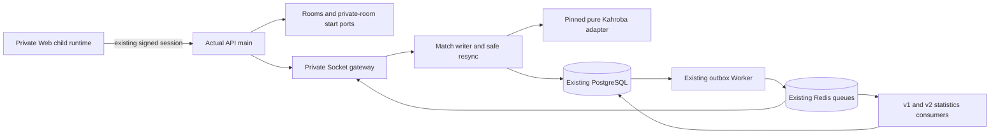

# Kahroba application runtime

The actual `apps/api/src/composition/main.ts` → `startApi` path now optionally creates the trusted private runtime. The actual Worker entry point creates the existing outbox dispatcher and statistics consumers. The normal configuration remains unchanged.

## Controls

`parseKahrobaRuntimeConfig` validates profile, four flags, queue namespace and transport lease policy before database connection. Flags have the hierarchy `admission → routes → runtime → registered`. Runtime construction is lazy behind routes; unused registrations do not create a public application surface. Turning new admission off keeps enabled routes and active matches usable. Removing the existing approved identity still revokes its session access under the original admission policy.

The private Game facade is owned by Games; no other module queries Games tables. Its validated registration is injected through Games' public port into Rooms/start. A durable `DISABLED` Game row is required, with verified identity, capacity, config version and empty config. The ordinary catalog repository still defaults to Coup; no public Kahroba tile or matchmaking is activated. Chat/matchmaking through the private gateway are explicitly denied.

Auth owns Telegram HMAC/freshness and server session identity. REST and Socket use the existing authenticated session service, which rechecks admission. Client payload identity is never used. Metadata adds two authenticated REST responses, one for capabilities and one for the membership-authorized public roster. Invalid/foreign matches are concealed with NOT_FOUND, following resync conventions. Player data is resolved through the Users public names port after the snapshot transaction; no network I/O is added inside a Match transaction.

The generic gateway receives the existing HTTP composition's production/trusted-proxy options, distributed admission, Redis delivery and presence leases. Personal gameplay retains its separate namespace/path and existing engine pins. Both transports share one listener with narrowly scoped upgrade coexistence. The Worker personal automation repository remains filtered to personal matches; ordinary human Kahroba gets no automatic takeover or turn timeout. Kahroba adapter rule duration and timeout policy remain null.

Match transactions, version checks, idempotent receipts, safe projections, restore validation, append-only events, finish-v2 truth and shared statistics are the K2 implementation. No new schema, result version change, old pin removal or migration was added in K4A.

## Web and packaging

`VITE_KAHROBA_RUNTIME=true` is a gated affordance, accepted only for local development at 127.0.0.1 or the existing exact staging origins. Server flags/admission govern access independently. `#/restricted/kahroba` supports private create/join/start/ready and table routes; existing public navigation defaults are preserved. Room refresh is an ordinary read poll, not a game-turn policy. Server-issued sessions are memory-only; child disposal clears its caches/private view. Room and readiness intents capture one ID/version before execution and retain them on ambiguous retry.

The build flag is included in immutable candidate build identity and Docker build arguments. Legacy manifests retain their old identity formula. Packaging refuses a private-enabled Web artifact for other origins. Role preparation accepts only the explicit additional fields and checks paired API/Worker profiles, namespace, existing owner/tester policy, room target and required v2 consumers; all earlier TLS/credential/private-network/scan guards remain.

Contracts: `kahroba.runtime.v1.json` and its initial baseline document private REST and Socket surfaces. Existing Room/realtime schemas are reused. Unsupported events are documented as denied. The gameplay view remains version 1 and result payload version 2; these are distinct versions.

Local actual-main acceptance is distinguished from synthetic edge fixtures and native staging acceptance in the [K4A report](../testing/kahroba-k4a.md). Deployment is unperformed.
