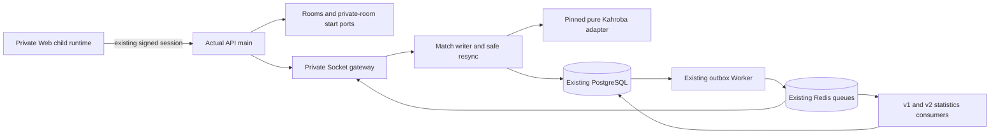

# Kahroba application runtime

The actual `apps/api/src/composition/main.ts` → `startApi` path now optionally creates the trusted private runtime. The actual Worker entry point creates the existing outbox dispatcher and statistics consumers. The normal configuration remains unchanged.

## Controls

`parseKahrobaRuntimeConfig` validates profile, four flags, queue namespace and transport lease policy before database connection. Flags have the hierarchy `admission → routes → runtime → registered`. Runtime construction is lazy behind routes; unused registrations do not create a public application surface. Turning new admission off keeps enabled routes and active matches usable. Removing the existing approved identity still revokes its session access under the original admission policy.

The private Game facade is owned by Games; no other module queries Games tables. Its validated registration is injected through Games' public port into Rooms/start. A durable `DISABLED` Game row is required, with verified identity, capacity, config version and empty config. The ordinary catalog repository still defaults to Coup; no public catalog tile is activated. Within the admitted Kahroba namespace, standard matchmaking supports capacities 2, 3 and 4 through the shared Redis/PostgreSQL ports. Chat remains denied. See [ADR 075](../adr/075-kahroba-palace-lobby-public-matchmaking.md) for the current palace lobby scope and pregame recovery policy.

Auth owns Telegram HMAC/freshness and server session identity. REST and Socket use the existing authenticated session service, which rechecks admission. Client payload identity is never used. Metadata includes authenticated capabilities, current room/search recovery, membership-authorized public rosters/readiness, and explicit host start/cancel operations. Invalid/foreign matches are concealed with NOT_FOUND, following resync conventions. Player data is resolved through the Users public names port after the snapshot transaction; no network I/O is added inside a Match transaction.

The generic gateway receives the existing HTTP composition's production/trusted-proxy options, distributed admission, Redis delivery and presence leases. Personal gameplay retains its separate namespace/path and existing engine pins. Both transports share one listener with narrowly scoped upgrade coexistence. The Worker personal automation repository remains filtered to personal matches; ordinary human Kahroba gets no automatic takeover or turn timeout. Kahroba adapter rule duration and timeout policy remain null.

Match transactions, version checks, idempotent receipts, safe projections, restore validation, append-only events, finish-v2 truth and shared statistics are the K2 implementation. No new schema, result version change, old pin removal or migration was added in K4A.

## Web and packaging

`VITE_KAHROBA_RUNTIME=true` is a gated affordance, accepted only for local development at 127.0.0.1 or the existing exact staging origins. Server flags/admission govern access independently. `#/restricted/kahroba` renders the approved palace lobby with private create/invite/join, public search, ready/host-start and table routes. Every admitted user may create a two-, three- or four-player room. Public search matches only the selected capacity and navigates automatically after credential-bound admission. Roster and readiness come exclusively from the server. Online/demo counts and the removed scan control are absent. Sound/motion preferences are local UI settings; account portraits/names come from authenticated profiles. Room refresh is an ordinary read poll, not a game-turn policy. Server-issued sessions are memory-only; child disposal clears its caches/private view. Room and readiness intents capture one ID/version before execution and retain them on ambiguous retry.

The build flag is included in immutable candidate build identity and Docker build arguments. Legacy manifests retain their old identity formula. Packaging refuses a private-enabled Web artifact for other origins. Role preparation accepts only the explicit additional fields and checks paired API/Worker profiles, namespace, existing owner/tester policy, room target and required v2 consumers; all earlier TLS/credential/private-network/scan guards remain.

Telegram invitation hints are captured before launch URL cleanup and passed separately from the signed credential and inherited memory session. The current URL's credential `start_param` takes precedence, followed by query/fragment `tgWebAppStartParam`, then SDK hints when no current URL credential is supplied. Current URL credentials replace stale SDK bytes without being re-encoded; malformed or duplicate current hints do not restore an older invitation. SDK/credential initialization for an invitation has the existing bounded ten-second startup deadline. A launch invitation selects its invitation route even if Telegram retained a different Kahroba route. A cached document handles new launch fields on hash/history navigation and SDK activation: hint-only navigation can retain its existing live session, while supplied or changed credentials dispose the old parent/child runtimes and require server verification again. Normal game route changes do not reauthenticate. The lobby retains the invitation label while its authenticated preview and transport are pending; joining remains disabled until the existing server and Socket checks succeed. No launch hint establishes identity, admission or membership, and no credential cache is added.

Contracts: `kahroba.runtime.v1.json` and its initial baseline document private REST and Socket surfaces. Existing Room/realtime schemas are reused. Those historical snapshots retain their original denied-event lists. The current additive surface is documented in `kahroba.lobby.v2.json`, including supported standard matchmaking events and membership-bound public lobby/current-ticket reads. The gameplay view remains version 1 and result payload version 2; these are distinct versions.

Local actual-main acceptance is distinguished from synthetic edge fixtures and native staging acceptance in the [K4A report](../testing/kahroba-k4a.md). Deployment is unperformed.

## Main-lobby deployment, 2026-10-23

[ADR 076](../adr/076-kahroba-main-lobby-entry.md) activates the existing Kahroba card for authenticated, admitted identities when its runtime/routes/admission are enabled. The floating private-entry link is removed. Kahroba uses WebSocket-only transport to match the bound staging ingress, independently of the generic transport. The [deployment record](../operations/kahroba-palace-deployment-20261023.md) records the actual server release, preserved cohort/data and its verification scope.
