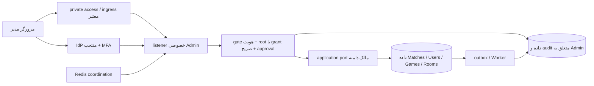

# مدل تهدید HamBazi Admin — فاز صفر

> **تصمیم جدید مراسم Staging — [ADR-084](../adr/084-staging-owner-private-ssh-ceremony.md):** دو امضای Ed25519 و فایل credential خام برای Staging با پروفایل صریح SSH/root/TTY، تأیید عمل، checkpoint و Audit خصوصی جایگزین می‌شوند؛ Recovery به Password فعلی همان OWNER نیاز دارد. backup رمزگذاری‌شده و تمرین restore خارج سرور پیش‌نیازند. این تغییر محلی است؛ نصب، حساب واقعی، public ingress و فاز دو مجاز نشده‌اند. مطالب قبلیِ دو proof در این محدوده تاریخی‌اند؛ برای محیط‌های دیگر پابرجا هستند.

> **تصمیم جدید ۲۰۲۶-۱۰-۲۶ — [ADR-083](../adr/083-admin-public-https-and-self-credential-rotation.md):** مسیر استفادهٔ عادی، Public HTTPS با احراز هویت و Reverse Proxy محدود است؛ الزام SSH-only برای مرورگر منسوخ می‌شود. Backend/DB/Redis و Bootstrap/Recovery خصوصی می‌مانند. تغییر Password و PIN خود OWNER و ابطال نشست‌ها ادامهٔ محدود فاز یک‌اند. کد/تست محلی مجاز است؛ نصب سرور، Firewall، فعال‌سازی عمومی، حساب واقعی و فاز دو تأیید نشده‌اند. نصب فعلی سرور تا مجوز جدا همان SSH-only است. این یادداشت در موضوع ingress بر بندهای تاریخی پایین مقدم است.

> **بازنگری معتبر فاز یک — ۲۰۲۶-۱۰-۲۵:** [ADR-081](../adr/081-admin-local-password-and-owner-pin.md) تصمیم جدید و مرجع احراز هویت Admin است: ورود محلی Username/Password، مرحلهٔ PIN ثابت شش‌رقمی فقط برای OWNER، قفل دائمی پس از سه PIN اشتباه و بازیابی خصوصی با دو proof مستقل. Password + PIN ثابت **MFA مستقل یا مقاوم به فیشینگ نیست**. بندهای قبلی OIDC/IdP، MFA خارجی، ورود/دعوت بر اساس subject خارجی و بازیابی provider در این سند در محدودهٔ Admin منسوخ‌اند؛ اصل OWNER/RBAC/private ingress/audit و یکپارچگی بازی حفظ است. فاز یک با تأیید صریح مالک آغاز شده؛ [گزارش اجرایی فاز یک](../implementation/admin-dashboard-phase-1.md) دامنه و شواهد جاری را مشخص می‌کند. فاز دو، حساب واقعی و deployment مجوز ندارند. مطالب «فقط Markdown/فاز صفر» در بخش‌های قدیمی، سابقهٔ زمان تدوین‌اند.

تاریخ: ۲۰۲۶-۱۰-۲۵. نوع بررسی: **design/source review**، نه penetration test یا تأیید محیط زنده.

مرجع: [ADR-039](../adr/039-administrative-security-design.md)، [ADR-078](../adr/078-admin-dashboard-architecture.md)، [ADR-079](../adr/079-owner-and-admin-access-control.md)، [گزارش فاز صفر](../implementation/admin-dashboard-phase-0.md) و [spec دسترسی و AC-01…AC-22](../architecture/admin-access-control.md).

## ۱. دارایی و عامل تهدید

دارایی‌ها: root binding و ownershipEpoch، اعتماد issuer/key/MFA، session metadata و sessionEpoch، نقش/override/scope، decision grant و approval، audit/receipt/outbox، metadata هویتی مجاز، hidden state و resultهای بازی، DB/Redis credentials، منابع اجرای بازی و کنترل deployment/containment.

عامل‌های تهدید: کاربر اینترنتی، بازیکن دارای token معتبر، Bot دارای credential محدود، مدیر کم‌اختیار، مدیر مخربِ دارای چند role، مهاجم با session سرقت‌شدهٔ OWNER، مهاجم زنجیرهٔ تأمین و اپراتور میزبان/DBA/IdP دارای اختیار بیرونی. پیش‌فرض این نیست که MFA یا private network به‌تنهایی همهٔ این عوامل را متوقف می‌کند.

## ۲. trust boundaryها

فلش، مجوز دسترسی خام نیست. credential audit و root ceremony محدودند؛ Worker معمولی audit را overwrite نمی‌کند. Admin به PlayerView با هویت ساختگی وارد نمی‌شود. شبکهٔ Docker خصوصی و listener جدا، isolation حافظه یا مصونیت از host compromise ایجاد نمی‌کنند.

## ۳. ثبت تهدید، کنترل و آزمون

شدت قبل از کنترل بیان شده؛ کنترل‌ها در این فاز **طراحی** هستند. مسئول، owner پیاده‌سازی/بررسی است و نام شخص واقعی تعیین نمی‌کند.

| ID / شدت     | سوءاستفاده                                                    | کنترل الزامی                                                                                            | تست/فاز/مسئول                                                                  |
| ------------ | ------------------------------------------------------------- | ------------------------------------------------------------------------------------------------------- | ------------------------------------------------------------------------------ |
| AT-01 بحرانی | player/Bot token یا claim OWNER روی Admin                     | issuer/audience/key/session مستقل؛ root binding DB، نه claim/body                                       | AC-01/02؛ فاز ۱؛ Admin Identity                                                |
| AT-02 بحرانی | Super Admin با role خود، bulk یا mass assignment root می‌شود  | OWNER_ONLY غیرقابل واگذاری؛ target root guard؛ DTO strict؛ permission registry از release               | AC-03/04/05/22؛ فاز ۱ guard، فاز ۲ mutation؛ Admin Access                      |
| AT-03 بحرانی | حذف/disable/unbind مالک با endpoint غیرمستقیم                 | binding خارج CRUD، FK/grants/guard؛ حساب بازیکن مستقل                                                   | AC-04/20؛ فاز ۱/۲؛ Admin و Database                                            |
| AT-04 بحرانی | first-login-wins یا replay bootstrap بعد restore              | manifest identity-bound، singleton، one-time receipt و نصب بیرون snapshot                               | AC-06/07؛ فاز ۱؛ Bootstrap/Operations                                          |
| AT-05 بالا   | سرقت invitation و activation با email مشابه                   | identity+MFA، accept اتمیک، owner review subject نامعلوم و expiry                                       | AC-08؛ فاز ۲؛ Admin Management                                                 |
| AT-06 بالا   | role/scope قدیمی از cookie/cache/Redis loss                   | snapshot current primary، policyRevision، sessionEpoch؛ lease ≤۵s؛ deny در عدم تأیید                    | AC-09/10/11/12؛ فاز ۱ پایه، فاز ۲ تغییرات؛ Access                              |
| AT-07 بحرانی | self-approval، replay proof یا تبدیل SSO گرم به reauth        | distinct human برای غیرمالک؛ OWNER_FINAL با challenge/digest/epoch/fresh proof                          | AC-13/14/15؛ فاز ۲؛ Approval/Identity                                          |
| AT-08 بحرانی | emergency دائمی یا recovery ضعیف مالک                         | authenticator مستقل از پیش enrolled، UV، ≤۱۰min و allowlist؛ audit/network اجباری                       | AC-18؛ پس از drill مصوب، فاز recovery؛ Security/Operations                     |
| AT-09 بحرانی | اثر بدون audit یا دو اثر بعد timeout/crash                    | admission پایدار قبل effect، receipt/outbox atomic، event dedupe و reconciliation                       | AC-16/17؛ audit پایه فاز ۱، بین ownerها فاز ۲؛ Admin/Worker                    |
| AT-10 بالا   | CSRF sibling-domain، fixation، XSS در نام مدیر/پرونده         | host-only secure cookie، CSRF+Origin، session rotation، CSP و escaping، no persisted UI secrets         | AC-21/22؛ فاز ۱ و هر فرم؛ Web/Admin                                            |
| AT-11 بحرانی | origin bypass، header spoof یا issuer/JWKS دلخواه/SSRF        | peer/Origin trust صریح، strip headers، egress allowlist کلید، exact OIDC trust                          | AC-01/22؛ فاز ۱؛ Ingress/Identity                                              |
| AT-12 بحرانی | مشاهدهٔ deck/رویداد خام یا impersonation برای resync/stats    | DTO allowlist مالک، منع raw state/chat/auth، Admin read port مستقل                                      | AC-19/22؛ فاز ۱؛ Owners و Security                                             |
| AT-13 بالا   | نشت از count/search/export با scope محدود                     | row filter و projection پیش از query/count؛ cursor scope-bound؛ export permission مستقل                 | AC-09/21/22؛ فاز ۱ و export آینده؛ Owners                                      |
| AT-14 بحرانی | termination با version کهنه، force-win یا engine swap         | writer موجود، target/expectedVersion، pins و ممنوعیت ویرایش result/hidden state                         | AC-19 و race suite؛ فاز ۲؛ Matches                                             |
| AT-15 بالا   | maintenance UI فعال ولی admission در رقابت ادامه دارد         | REQUESTED/APPLYING/EFFECTIVE، owner-local fence/epoch و reservation guard                               | race admission/start/cancel؛ فاز ۲؛ Games/Rooms/Matches                        |
| AT-16 بالا   | export/rebuild/dashboard منابع بازی را اشباع می‌کند           | query/statement/pool/in-flight bounds، coalescing، workload measurement و worker محدود                  | fault/load؛ بودجه قبل read واقعی، اثبات کامل فاز ۴؛ Operations                 |
| AT-17 بالا   | audit با UPDATE/TRUNCATE یا retention shortcut پاک می‌شود     | append-only واقعی، grant/trigger، maintenance identity جدا و retention مصوب                             | AC-16/19؛ فاز ۱ پایه/۲؛ Database/Security                                      |
| AT-18 بالا   | telemetry یا queue حاوی assertion/token/chat/raw error        | schema allowlist، content-free outcome، fixed labels، هیچ auto-capture                                  | canary information-flow؛ تمام فازها؛ Observability                             |
| AT-19 بالا   | endpoint جدید فاقد permission یا Super Admin wildcard         | metadata اجباری handler، registry واحد، explicit grant، OWNER خودکار فقط پس از ثبت                      | AC-02/05/22 و architecture/contract fixtures؛ فاز ۱؛ Tooling                   |
| AT-20 بالا   | DB snapshot restore، session یا approval قدیمی را احیا می‌کند | recovery ownership/policy/session epoch reconciliation، receipt preservation، external installed marker | AC-07/11/16 و restore drill؛ فاز ۱ design proof، فاز ۴ operational؛ Operations |

برای incident بدیهی مانند audit outage، «مالک دسترسی کامل دارد» مجوز bypass نیست. در gateهای قبل از commit تغییر مجوز، in-flight semantics معتبر و audited است؛ فقط رکورد زمان revoke به‌تنهایی اثبات جلوگیری از اثر قبلاً admitted نیست.

## ۴. رفتار در failure

| dependency خراب          | پاسخ مورد انتظار                                                                                                                | چیزی که نباید رخ دهد                                 |
| ------------------------ | ------------------------------------------------------------------------------------------------------------------------------- | ---------------------------------------------------- |
| IdP                      | login/reauth عادی رد؛ session جاری فقط طبق freshness policy مصوب و verification معتبر؛ emergency فقط پس از pre-enrollment/drill | fallback به Telegram/email/مقادیر request            |
| primary DB               | authorization/session/root قابل تأیید نیست؛ read و mutation محافظت‌شده fail closed                                              | استفاده از role cache کهنه یا Redis به‌عنوان truth   |
| audit پیش از admission   | صفر اثر جدید؛ code ثابت و metadata امن                                                                                          | execute سپس «بعداً log می‌کنیم»                      |
| audit outcome بعد commit | اثر حفظ؛ outcome از outbox reconcile و قابل مشاهده                                                                              | undo ساختگی، تکرار با commandId جدید یا حذف evidence |
| Redis                    | quota معتبر لازم؛ stale permission ممنوع؛ logout durable محفوظ                                                                  | override جدید با cache، گم‌شدن Match یا audit        |
| notification             | outcome مستقل و retryable با reference؛ failure معلوم                                                                           | حذف audit یا rollback اثر commit‌شده                 |
| Admin خراب               | پنل degrade/بسته؛ gameplay به dependency جدید Admin وابسته نشود                                                                 | تغییر root/game history برای بالا آوردن پنل          |

## ۵. ریسک‌های باقیمانده و gate

Compromise کامل process مشترک API ممکن است به credentialهای ownerها برسد؛ جدایی listener/pool دفاع کامل نیست. DBA، root host، IdP administrator و key custodian نیز توان بیرونی دارند؛ grantهای برنامه مرز آن‌ها را اثبات نمی‌کند. archive/checkpoint مستقل، custody و least privilege بیرونی و در صورت نیاز process isolation باید قبل production review شوند.

حق مشاهدهٔ همهٔ قابلیت‌ها برای OWNER، جلوگیری مطلق از سوءاستفادهٔ عمدی مالک نیست؛ owner reauth/audit و immutable domain invariants اثر را محدود و قابل‌پیگیری می‌کنند. policy recovery با هویت واقعی و provider هنوز qualifier نشده است. تا انتخاب و آزمون IdP/network/session/retention، «امنیت اجراشده» اعلام نمی‌شود.

خروجی این فاز صرفاً threat coverage است. اجرای تست‌های ATها به فاز مجاز مربوط منتقل می‌شود؛ هیچ حمله یا probe به محیط واقعی در این فاز انجام نشده است. راهنمای [OWASP Authorization](https://cheatsheetseries.owasp.org/cheatsheets/Authorization_Cheat_Sheet.html) برای permission gate و deny-by-default غیرمالک مرور شد؛ استثنای OWNER و policyهای عددی، تصمیم خاص HamBazi هستند.

## بازنگری تهدید Local Auth در فاز یک

| تهدید جدید                                | کنترل و محدودیت                                                                                                                                 | evidence محلی                                                        |
| ----------------------------------------- | ----------------------------------------------------------------------------------------------------------------------------------------------- | -------------------------------------------------------------------- |
| brute-force آفلاین PIN شش‌رقمی با dump DB | HMAC pepper خارج DB سپس Argon2id/salt؛ compromise هم‌زمان pepper این دفاع را تضعیف می‌کند                                                       | pepper مستقل و parameter bounds                                      |
| قفل عمدی مالک با password سرقت‌شده        | سه failure durable مطابق درخواست؛ recovery خصوصی؛ ریسک DoS باقی است                                                                             | concurrency/retry/restart PostgreSQL                                 |
| شمارش با username تنها یا preauth جعلی    | password معتبر و pending signed/kind/expiry/epoch لازم؛ API کامل pending را نمی‌پذیرد                                                           | Unit و HTTPS                                                         |
| replay تغییر PIN، recovery یا پاسخ گم‌شده | digest keyed، command receipt، امضای عمل/target/زمان و fencing نسخه؛ receipt fail closed                                                        | Unit و integration                                                   |
| گرسنگی CPU/DB بازی با Argon2              | entry point همان artifact با process مستقل، KDF همزمان محدود، pool/read صفحه‌بندی و limiter Redis؛ بودجهٔ بار مشترک هنوز تصویب/اندازه‌گیری نشده | bounds/config/security tests؛ load مشترک اجرا نشده                   |
| phishing/سرقت هر دو secret                | Password + PIN ثابت MFA مستقل نیست؛ private ingress/Origin/CSRF/rate limit/Audit کنترل جبرانی‌اند                                               | ریسک باقیماندهٔ مصوب؛ ادعای مقاومت phishing وجود ندارد               |
| credential معمول DB برای recovery         | runtime حق unlock ندارد؛ ابزار root، دو امضای مستقل و custody بیرونی لازم دارد                                                                  | DB grants/trigger + dual proof tests؛ root/DBA مخرب trust بیرونی است |
